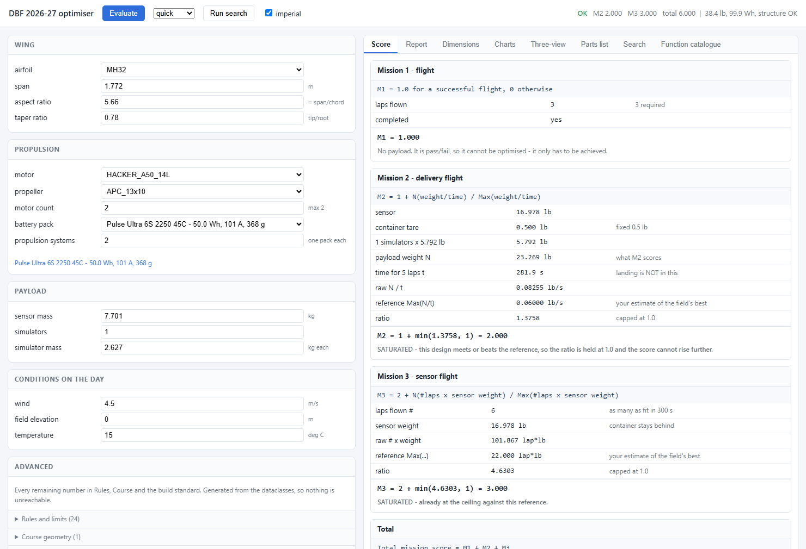

# DBF 2026-27 Mission Simulator and Design Optimiser

Sizes an aircraft, flies all three missions, scores them, and returns both
the design and the parts list to build it. There is a desktop front end if
you would rather turn knobs than edit JSON.

**No dependencies.** Pure Python standard library: no `pip install`, no
numpy, no matplotlib. Python 3.8+, verified on 3.13.

```bash
python dbf.py --gui                   # desktop front end
python dbf.py --web                   # the same thing in a browser
python dbf.py --quick                 # fast search (~1.5 min on 16 cores)
python dbf.py                         # default search (~6 min before the 2026-10-03 physics; slower now, not re-timed)
python dbf.py --thorough              # wide search (hours: a widened 1-2 motor search took 9.9 h on 16 threads)
python dbf.py --evaluate design.json  # score one aeroplane, print its parts
python dbf.py --catalogue             # index every function in the package
python dbf.py --rules                 # every rule, and where it is enforced
python dbf.py --selftest              # 437 physics and scoring invariants
python dbf.py --validate              # 2373 integrity and interface checks
python dbf.py --guitest               # 183 GUI checks, driven headlessly
python dbf.py --webtest               # 105 web checks, over real HTTP
python dbf.py --convergence           # numerical error study
python dbf.py --audit results/ranked_designs.csv   # which options won
python dbf.py --version
```

`dbf.py` is a dispatcher, not the program. The code lives in the
`dbf2027/` package beside it, one module per concern.

**On a cluster:** `python cluster/make_cluster_bundle.py` builds
`dbf-optimizer-cluster/` beside this folder. It holds the search modules,
copied unchanged, plus Slurm scripts for UGA Sapelo2: one node, job arrays
or MPI across nodes. See `cluster/README-cluster.md`.

**Stall-limit sweep results:** the best design at each stall limit
(30-50 mph, and none), with its motor, propeller and battery and a
design file for `--evaluate`, is in `examples/stall_limits_v6/` - start
with its README.

## The graphical front end

```bash
python dbf.py --gui        # or: python dbf_gui.py
```


Left is input, split deliberately:

* **Setup** — which design is under test, in what weather, scored against
  what. **Air density** sits with the conditions, because it is the
  quantity that actually reaches every lift, drag and propeller
  calculation — elevation and temperature are only a way of arriving at
  it. Editing either recomputes it; typing a density overrides them,
  which is what you want when someone has read one off a weather station
  at the field. It shows the equivalent **density altitude in feet**
  alongside, which is the number people actually talk about. There are **no design fields here**: the aeroplane comes from a
  search or from a file, and a one-line caption names it and says where it
  came from. Conditions (wind, field elevation, temperature) and the
  scoring normalisers do apply to the loaded design — change one and press
  Evaluate.
* **Search space** — the **ranges `Run search` explores**, and the only
  design input on the left. Span, aspect ratio and taper ranges, sensor
  mass range, Mission 3 sensor fraction, drop-height range, and which
  motor and propulsion-system counts to try. Narrow them to steer the
  search; widen them to let it roam.
* **Advanced** — every remaining number in `Rules` and `BuildStandard`:
  areal densities, safety factors, gust speeds, tail volume coefficients,
  pilot efficiency, every rules limit. This panel is **generated by walking
  those two dataclasses**, so a field added to the model appears here
  automatically instead of being quietly unreachable. `--guitest` asserts
  that every field maps to a real attribute. The build standard is
  **grouped by what each number is**: safety margins first, then the
  estimates to replace with measurements, design choices, how it is
  flown, and physical constants. Each has a one-line note (see
  *Margins, estimates and computed corrections* below).

Right is output: the full dossier with a constraints verdict at the top, a
dimensions table, four charts, a scale three-view, the score, a **Margins**
tab, the parts list, the search log, and the function catalogue with a live
filter. The Margins tab lists every number the answer rests on. The safety
margins show what each holds back on the loaded design (Wh, kg, g). The
corrections the model computes show the fixed factor each replaced.

> **Why there is no design form.** There used to be one, and the Report
> tab restated every one of its thirteen values — the same numbers in two
> places with nothing saying which was authoritative. The design is now a
> single piece of state that a search or `Load...` sets; the Report,
> Dimensions and Score tabs are where you read it. What the left panel
> keeps is what the Report cannot tell you: which aeroplane is loaded,
> where it came from, and what conditions it is being flown in.
>
> The search log prints the ranges it actually used, above the ranking, so
> a result always carries the space that produced it.

**Run search** runs the real optimiser on a worker thread, so the window
stays responsive. A **progress bar** in the status bar at the bottom of
the window shows which of the five stages is running, how many items of
that stage are done, the overall percentage, and roughly how long is left.
The stages are weighted by their measured cost, so the estimate settles
after the first few percent. The **Weather plan** button shows a busy bar
while it flies its three presets. When the search finishes, the winning
design is loaded straight back into the form so you can start perturbing
it.

### The charts

| Chart | What it answers |
|---|---|
| **Drag and thrust vs speed** | How fast can it go, and how hard is it working? Drag is drawn at empty, Mission 3 and Mission 2 weight, with the full-throttle thrust curve over the top — each crossing is that weight's top speed |
| **Lift vs drag** | The drag polar in force units at a fixed speed, with both mission weights marked. A weight line above the curve means the wing cannot hold it up at that speed |
| **L/D vs speed** | Where the peak sits, and how far it moves as the aeroplane gets heavier — which is why M2 and M3 want different cruise speeds |
| **Power required vs speed** | Power, not drag, is what empties the battery. The red rule is the average power that drains the pack inside the window |
| **Speeds vs weight** | Stall, best-L/D and top speed against gross weight. Where stall meets top speed, it stops flying |

Units toggle between imperial and SI, and any chart exports to CSV.

Charts are drawn on a plain tkinter `Canvas` from geometry computed in
`dbf2027/plots.py`. That module holds no tkinter at all — it produces
series, axis ranges and tick positions in data units, and the canvas only
strokes lines along them. The split is why chart *correctness* can be
tested without a display, and it is tested: axis mapping, tick spacing,
degenerate ranges, and physical invariants like stall speed rising with
weight.

### The three-view

A scale plan and side view sharing one scale, with a metre rule and span
and length callouts. It is crude on purpose — enough to see that the tail
arm is sane, that the propellers clear each other and the ground, and that
the fuselage is as long as the payload bay forced it to be.

## The same thing in a browser

```bash
python dbf.py --web                    # http://127.0.0.1:8000
python dbf.py --web --host 0.0.0.0     # reachable from your team's laptops
python dbf.py --web --port 9000
```



Same model, same charts, same numbers — a different front end. The page is
one HTML document served by a standard-library HTTP server. No Flask, no
Django, no npm, no CDN: `python dbf.py --web` and open the link.

**Charts are rendered server-side as SVG**, by `plots.chart_svg`, which goes
through the exact same `Mapper` the desktop GUI uses to stroke a tkinter
canvas. So a chart is identical in both front ends, there is no JavaScript
charting library to depend on, and there is only one place a chart can be
wrong. The browser does `innerHTML = svg` and nothing else. Every number on
screen was computed by the Python model.

The JSON API is small enough to drive from a script:

| Route | Does |
|---|---|
| `GET /api/meta` | catalogues, and every editable field on `Rules`, `Course` and `BuildStandard` |
| `POST /api/evaluate` | a design + config → report, score blocks, dimensions, chart SVG, three-view SVG, parts list |
| `POST /api/search` / `GET /api/search` | start a search, poll it |
| `GET /api/catalogue?q=` | the function catalogue, filtered |

### Putting it on a real URL

`--web` serves on your own machine; `--host 0.0.0.0` puts it on your local
network, which is enough for a design review round a table. **It is not
hardened for the public internet** — no authentication, no TLS, no rate
limiting, and a search will use every core on the box.

To host it publicly you would need somewhere that runs Python, and three
changes first: put it behind a real WSGI/ASGI server rather than
`http.server`, add authentication, and bound the search (one job at a time,
a hard timeout, and a cap on cores) so one visitor cannot occupy the
machine for twenty minutes. Nothing here is hard; it is just not done, and
pretending otherwise would be worse than saying so.

## Rules traceability

```bash
python dbf.py --rules              # the matrix, in the terminal
python dbf.py --rules --brief      # titles and locations only
python dbf.py --rules --markdown   # write RULES.md
```

[`RULES.md`](RULES.md) lists **every requirement from the 2026-27 rules
package that bears on this model** — 44 of them — with the quoted
requirement, how the model handles it, and **the file and line that
enforces it**.

A comment saying *"rule 3.1.3 says simulators must match the container"*
is worth something the day it is written and nothing two refactors later,
because nothing checks it. So the rules live as data in
[`dbf2027/rulebook.py`](dbf2027/rulebook.py), the code carries `# RULE <id>`
markers, and `--validate` reads the source back and fails if the two have
drifted:

- **every enforceable rule has at least one marker** — delete the line that
  enforces a rule and its marker goes with it, and the build fails;
- **every marker names a rule that exists** — a typo or a stale section
  number is caught;
- the scoring rules and hard limits must be enforced **outside `config.py`**,
  so a rule cannot be "implemented" by declaring a constant nobody reads;
- enforcement must live in the package, not only in a test.

Both failure modes are demonstrably live: removing the only marker for a
rule, or inventing a `RULE 9.9.9`, each fail the suite.

Rules are classified by what they actually are:

| kind | meaning | count |
|---|---|---|
| `limit` | a hard constraint; a design that breaks it is rejected | 9 |
| `model` | changes a computed number | 19 |
| `score` | part of a scoring formula | 6 |
| `build` | physical or procedural — **no simulator can check it** | 10 |

That last row is the honest part. Arming-plug placement, hatch latching,
fail-safe settings, container markings, the charging sack — these are real
requirements that get teams failed at tech inspection, and nothing here can
verify them. They are registered anyway, marked `build`, so they are
visible rather than silently absent. The parts list names the ones that
are purchasable.

Three entries are worth reading. **3.2.1e** — the propeller may change
between flights: the model uses this across the weather, so a finalist may
fly a different propeller on a cool morning or a hot afternoon, but not
between missions on one day, which is conservative. **3.3.3b** — Mission 1
may be waived: modelled, so a successful Mission 2 also earns the Mission 1
point. **3.3.3a** — the one that shapes the whole design: Mission 3 may not
be flown until Mission 2 has scored, so a design that fails Mission 2 scores
nothing for Mission 3 either.

## The component catalogues

The **Catalogues** tab lists every stored component — 32 airfoils, 45
motors, 31 propellers (27 UIUC-measured), 46 COTS battery packs (LiPo,
LiHV and Li-ion, 3S–12S), 21 ESCs — with all of its values, and lets you
add your own. Retired entries are greyed: they are kept only so saved
designs still open, and the search leaves them out (below).

**Researched 2026-09-29, checked against physics before entry, then
pruned to the parts that earn a place.**

- **Motors:** 38 searched, from Scorpion, T-Motor, Cobra, KDE Direct,
  Hacker, SunnySky, AXI and Neu. They run from 165 g / 1.1 kW to
  672 g / 2.9 kW, cover 1–4 motor designs, and are rated for 5S to 14S. Every
  motor passed three checks at its rated current before entry:
  efficiency 0.75–0.96, copper loss under 1.4 W/g, and a motor constant
  `Km = Kt/√Rm` on the makers' common Km-vs-mass trend. Those checks
  caught two T-Motor typos, a Hacker copy error (the A50-16S resistance,
  now 0.027 Ω) and AXI's two conflicting resistance sets.
- **ESCs:** 21, from Castle, Hobbywing, Scorpion, KDE and Jeti. Only ESCs
  with no BEC, or a documented way to disable it, are entered (rule
  3.2.3b). **A published "continuous" rating is rarely 5 minutes at full
  throttle.** Scorpion rates 60 s in a 30–35 m/s airstream; KDE 180 s;
  Castle one pack's worth at 5 mph. So each ESC's rating is moved to the
  mission (300 s at `esc_airflow_mps`, 10 m/s) along the one published
  derating curve, Scorpion's (§5).
- **Packs:** 38 searched, from Tattu, Gens Ace, CNHL, Ovonic, Turnigy,
  Auline, Lumenier, Thunder Power, Pulse, Spektrum, SMC and MaxAmps, 22 to
  100 Wh. Each carries its measured true capacity and DC resistance where
  independent tests give them (§5). HRB is left out: tests delivered
  70–85% of its rated capacity.

**How the catalogues were pruned.** The study is in
`results/catalogue_prune_2026-09-29/`; `decisions.csv` there gives the
reason for every entry kept or cut.

- **ESCs (55 → 21), with no loss.** The search picks the lightest ESC
  that holds the current. Across the 421,000 of 1.85 million propulsion
  combinations that pass their ratings, only 22 ESCs were ever picked.
  15 of the others can never be picked: another ESC of no more mass holds
  at least their current at every run time, airflow and ambient. Two of
  the 22 have an equal-mass twin that holds more.
- **Packs (86 → 38 searched).** 23 were dominated: another pack of the
  same cell count and type holds at least their energy and current for
  no more mass, resistance or heating. The rest were flown (below). A
  pack stays if, at some system count, it is among the 6 best or within
  2% of the best. It also stays if it is the best of its own cell count
  and type, so every voltage from 3S to 12S, and LiHV and Li-ion, keeps
  one.
- **Motors (129 → 38 searched).** A motor stays if, at some motor count
  (1–4), it is among the 8 best, within 2% of the best, or among the 2
  best on packs of its voltage band (3–4S, 5–6S, 7–8S, 9–12S).
- **How they were flown.** 8,808 flights on the recommended airframe,
  with the payload scanned to the heaviest each carries well. Every motor
  flew with its own 8 best packs at every motor count, and every pack
  with its own 8 best motors. Then, so no part is judged only on the
  partners the screen's figure of merit picks, every motor also flew with
  the 3 best pack options at each motor count, and every pack with the 3
  best motor-and-propeller combinations.
- **Scored two ways.** Each flight was scored against the fixed
  field-estimate references the optimizer uses before it self-normalises.
  Those weight the Ground Mission most, so on its own that scale favours
  payload. So each flight was also scored the way the final ranking
  scores, with each mission counted equally. A part that passes on either
  scale stays. The two agree on 240 of 250 parts; the other scale kept one
  more motor and three more 6S 4500 packs.
- **Retired, not cut.** Seven motors and eight packs that saved designs
  or the tests name are kept loadable but left out of the search
  (`components.RETIRED`). That includes the 748 g Gens Ace 6S 4500 in the
  recommended design, which is dominated.

The propulsion screen is 7.2 times smaller (257,792 combinations).

```
catalogues/airfoils.csv   catalogues/motors.csv   catalogues/props.csv
catalogues/packs.csv      catalogues/escs.csv
```

Anything you add is written to those files and applied immediately: the
design you are evaluating, the next search, and the CLI all see it. Your
rows are tinted in the table so it is obvious which entries shipped with
the package and which are yours; built-in entries cannot be deleted, only
overridden.

**The table, the form and the CSV are all generated from one registry**
(`CATALOGUES` in `components.py`). A column added there appears in the
interface without touching the interface, and a row typed into the GUI
goes through the *same constructor* as a row read from a file — so the
two cannot drift apart. `--validate` proves it by taking each catalogue
entry, converting it to a row, rebuilding it, and checking the result is
identical.

> **Why this matters more than it looks.** The propeller used to be the
> single largest source of model error; it is now UIUC wind-tunnel data
> (§5). Your own thrust-stand runs, loaded with `--props-csv`, are still
> worth more than any amount of extra compute. Second is the battery
> catalogue: every pack is marked *VERIFY*, because masses and C ratings
> drift between production runs and the pack you can actually buy in March
> is the one that matters.

User entries are loaded **at package import**, not when the GUI starts.
That is deliberate: a search runs in worker processes that re-import the
package, and a motor that existed only in the parent process would vanish
partway through a sweep. There is a test that spawns a real `Pool` and
checks the workers can see an added motor.

## The function catalogue

```bash
python dbf.py --catalogue                  # print it
python dbf.py --catalogue --search trim    # only entries matching "trim"
python dbf.py --catalogue --markdown       # write FUNCTIONS.md
```

[`FUNCTIONS.md`](FUNCTIONS.md) indexes every public callable in the
package — **329 entries: 44 classes, 149 functions, 93 methods, 43
properties** — with its signature, defaults and one-line summary, grouped
by module in dependency order.

It is built by **introspection, not by hand**, so it cannot drift out of
date: `dbf2027/catalogue.py` walks the package with `inspect`, keeps only
objects actually defined in each module (so a re-export does not appear
twice), and takes the first line of each docstring as the summary. The
same records drive the GUI's catalogue tab and its filter box.

## What is in this repository

```
dbf.py                 entry point: dispatches every command
dbf_gui.py             double-clickable GUI launcher
dbf2027/               the model, one module per concern
catalogues/            your own components, applied at import (created on demand)
run_optimizer.py       the command-line interface
selftest.py            437 physics and scoring invariants
validate.py            2373 integrity, bounds, determinism, interface checks
guitest.py             183 GUI checks, driven without a human
webtest.py             105 web checks, over real HTTP
grid_convergence.py    numerical error study
analyse_results.py     which catalogue options reached the finals
README.md              this file: derivations, assumptions, limitations
README-core.md         the 21-file minimum that runs the GUI, and how to lay it out
FUNCTIONS.md           generated index of every function
RULES.md               generated rules compliance matrix
ASSUMPTIONS.md         the assumptions, gathered in one place
LICENSE                MIT
docs/                  GUI and web screenshots used by this file
examples/baseline.json      a hand-picked design, to try --evaluate
examples/optimised_v1.json  the recommended design - for now a stand-in.
                       The v1.17 thorough search's (2026-09-28): SD7062,
                       taper 0.43, 1x Neu 6521/3.5/362, Gens Ace 6S 4500
                       60C.  Its 16x12 cannot last a flight charged at
                       full throttle end to end (2026-10-02), so it is on
                       a 16x8 with a 24.6 lb sensor - the heaviest that
                       flies all three weather presets - until a
                       full-throttle thorough search replaces it.
                       Earlier results in results/thorough_final_2026-09-28/
examples/optimised_hacker_v1_16.json
                       the v1.16 recommendation (DAE21, Hacker A50-14L V3
                       400KV, 15x10, Thunder Power 7S 3850, 28.2 lb sensor),
                       on the old parametric propeller fit
examples/optimised_v1_neu6521.json
                       the v1.16 airframe with the Neu 6521/3.5/362 swapped in
examples/optimised_v1_15.json
                       the v1.15 recommendation (USA-35B, SunnySky X4120,
                       6S 4500), before sag, 95% discharge and the layout
examples/optimised_hacker_v1_14.json
                       the v1.14 recommendation (one propeller for all days)
examples/optimised_sd7003_v1_13.json
                       the v1.13 recommendation - chosen on the old motor data;
                       with the Scorpion's real numbers it overloads on a cool
                       morning
examples/optimised_e205_v1_12.json
                       the previous recommendation, on the old airfoil data
examples/stall_limits_v6/
                       the stall-limit sweep's pick at each limit (30-50
                       mph, and none) as --evaluate files, with their
                       parts and how to score them (its README.md).  Not
                       search seeds: only examples/*.json are
```

Clone it and run `python dbf.py --gui`. Nothing to install.

---

## Margins, estimates and computed corrections

Every number in `BuildStandard` is one of five kinds (`config.FIELD_ROLES`):

| Kind | What it is | Examples |
|---|---|---|
| **Safety margin** | held back on purpose against a failure that costs the mission, the aeroplane or a rule | factor of safety 1.5, Mission 2 energy margin 2%, depth of discharge 95%, mass contingency 8%, static margin 0.10, winding limit 110 °C |
| **Estimate to measure** | a real effect the model cannot compute; replace it with a test | areal densities, `cl_max_3d_factor`, `profile_drag_factor`, `excrescence_frac`, `pilot_efficiency`, `fuselage_lift_carryover` |
| **Design choice** | how you build or lay it out | tail volumes, gear tip-back, tail t/c, wing mount |
| **Operating** | how it is flown | bank limit, descent rate |
| **Physical constant** | | copper's temperature coefficient |

The rule followed: **a known effect with a known direction is modelled,
not left inside a margin**, and margins live only at the cliffs. So these
used to be fixed factors and are now computed for each design:

| Correction | How | Replaced |
|---|---|---|
| span efficiency over the fuselage | `e = e_wing (1 − 2(d/b)²)` (Kroo) | ignored |
| CLmax over the fuselage | the covered planform keeps `fuselage_lift_carryover` of its lift (1.0 for a top wing) | ignored |
| skin the wing and fuselage cover | not wetted: one wing surface over the fuselage and the fuselage top under it (both wing surfaces for a mid wing) | counted as wetted |
| junction interference | Hoerner, per root: `ΔD/(q t²) = 0.75 t/c − 0.0003/(t/c)²` | inside a flat +10% on all drag |
| installed thrust | slipstream scrubbing: `T_inst = T (1 − f/A_disc)` | flat 0.95 |
| windmilling propeller | each UIUC table extended to zero torque | flat 0.08 |
| tail form factor | Raymer, `1 + 2 t/c + 100 (t/c)⁴` | flat 1.25 |
| fuselage perimeter | rounded corners, `2(w + h) − (8 − 2π) r` | flat 0.92 |
| finite-span CLmax | the lifting-line stall alone | also × `min(1, 0.80 + 0.04 AR)` (counted twice) |
| slipstream turbulence | the wing behind the propeller loses part of its laminar run: its section drag moves `slipstream_transition_frac` (0.5) of the way to fully turbulent | ignored |
| slipstream lift | the lifting line with the jet's own airspeed across the span (below) | ignored |

The report's **MARGINS AND MODELLING FACTORS** section and the GUI's
Margins tab print all of it for the design in hand.

**The root chord was also wrong.** The model flies the area `b × c` (c the
mean chord), but the printed root chord came from the mean-*aerodynamic*-
chord formula, which draws a smaller trapezoid: 5% less area at taper 0.43
and 13% at taper 0.20. An aeroplane built from those chords would have had
less wing than the one simulated. The root chord is now `2c/(1 + λ)`, and
the MAC is printed separately.

---

## How to read this document

Each section states **what the model does**, **derives the formulas**, then
closes with two lists:

> **Assumptions** — what we decided, and what you would change it to.
>
> **Distance from reality** — what is missing, and which direction the error
> runs. This is the honest part. Read it before you trust a number.

Notation: `L` lift, `D` drag, `T` thrust, `W` weight, `q = ½ρV²`, `S` wing
area, `b` span, `c` mean chord, `AR = b²/S`, `n` load factor. SI internally,
imperial only for display.

---

# 1. What it computes, and the chain that connects it

Given a **design vector** the model builds the aeroplane, flies all three
missions and scores it. Given a **search space** it does that ~100,000 times
and reports the best.

Nothing is a standalone lookup. Change one number and it propagates:

```
payload count (sensor container + simulators, one fixed box size)
  -> payload bay, packed in the lowest-drag arrangement
  -> fuselage cross-section; bay centred on the CG
  -> tail arm (lightest tails + tailcone) -> tail area -> neutral point
  -> wing placed for the target static margin; battery placed to balance
  -> nose length and fuselage length from that layout
  -> wetted area -> parasite drag
  -> gross weight
  -> V-n diagram (manoeuvre vs gust vs CLmax ceiling) -> ultimate load factor
  -> spar sized for root bending at that load factor
  -> more structure -> more weight  (iterated to convergence)
  -> stall speed, turn rate, lap time, energy per lap
  -> mission score
```

"Carry one more container" is therefore not a weight penalty bolted on at
the end. It lengthens the fuselage, adds wetted area, moves and grows the
tail, thickens the spar, and slows every lap.

**The design variables**

| Variable | Representation |
|---|---|
| wing span | continuous, capped at the 6 ft rule |
| taper ratio | continuous 0.20–1.0; induced drag and tip stall both priced by the lifting-line solve |
| chord | derived from span and aspect ratio, so AR is always valid |
| airfoil | 32-entry airfoiltools catalogue (Re 500k XFOIL polars) |
| motor | 30-entry catalogue from the makers' pages, each with its rated cell count |
| propeller | 32 APC Thin Electric sizes, 27 with UIUC wind-tunnel data |
| motor count | 1 or 2 |
| battery pack | 31-entry COTS catalogue, LiPo 3S–12S and Li-ion, whole packs only |
| propulsion systems | 1 or 2, each carrying one identical pack |
| voltage, watt-hours | read off the pack label; total Wh capped at 100, and each pack capped at 100 |
| sensor mass | continuous, no ceiling |
| simulator count and mass | integer, continuous |

**Tail sizing.** Horizontal and vertical areas come from volume
coefficients, `S_h = V_h · S · c / l_t` and `S_v = V_v · S · b / l_t`. The
volumes are sized from what the tails must do (m111; ASSUMPTIONS.md has
the details):

- **Horizontal tail:** it must trim the flight envelope with 20% of its
  CLmax to spare, at every loading's CG. It must also rotate the
  aeroplane about its main wheels at the liftoff speed, and be at least
  V_h 0.30.
- **Fin:** it must give Cn_β 0.06 /rad against the fuselage. It must
  also hold one wing motor out at 1.2 × stall, and be at least V_v 0.020.

The horizontal tail volume is also searched (`--tail-vh`, 0.30 to 0.90)
and is never below its requirement. A bigger tail trims with less
download, which often pays (m112). The old fixed V_h 0.55 and V_v 0.040
remain as `tail_sizing = "volume"`.

The tail arm is calculated, not a fraction of anything. Tail areas fall
as `1/l_t` and the tailcone grows with `l_t`, so the arm that makes tails
plus tailcone lightest is

```
l_t* = sqrt( (ρ_h V_h S c + ρ_v V_v S b) / λ )
```

where `λ` is the tailcone's mass per metre (mean perimeter × fuselage areal
density, plus the boom). It is never shorter than the tailcone needs to
taper from the payload bay to the tail post at a 12° boat-tail angle
(steeper and the flow separates).

**Layout: every part placed, CG calculated** (`dbf2027/layout.py`). Nothing
about the fuselage length or where parts sit is assumed:

1. **The payload bay is centred on the CG**, so M1 (empty), M2 (full) and
   M3 (sensor towed from the bay) balance alike.
2. **The wing is placed** so that CG sits the target static margin
   (`target_static_margin`, 0.10) ahead of the computed neutral point.
3. **The battery is the trim weight.**
   - The nose holds the motor (single tractor), then the battery and
     electronics. Their lengths come from their masses: pack volume at
     the 2.1 g/cm³ the makers' dimensions give, motor length from
     outrunner density.
   - The battery slides to balance the aeroplane about the payload. If
     it cannot reach far enough forward, the nose is lengthened. If the
     aeroplane is nose-heavy (a long bay puts the nose far ahead of the
     CG), the battery goes behind the bay, if the tapering tailcone has
     room for it.
   - A margin up to `static_margin_band` (0.05) above target is accepted
     rather than lengthening the fuselage to hit it exactly.
4. **Fuselage = nose + bay + tailcone** to the tail's trailing edge. The
   gear is a tricycle, with mains at a 15° tip-back angle behind the CG.

The report's **LAYOUT** section lists every station: mass, position from
the nose, moment about the CG. It also gives the CG for each mission and
the static margin loaded and empty. The three-view draws the bay, the
battery and the CG where the layout put them.

> **Assumptions.** Straight-tapered wing; taper is a design variable and
> its effect on induced drag is solved, not assumed (§3). Fuselage is a
> box section around the payload bay. Its nose is sized by the parts in it
> and the balance, and it tapers to the tail post behind the bay (layout,
> above). Tail volume coefficients size the tail; the CG is placed for the
> target static margin and then *checked* (§4). Payload boxes pack into the
> arrangement (1–4 across, 1–3 high) with the least wetted area.
>
> **Distance from reality.** No twist, washout, sweep or dihedral. Taper
> runs down to 0.20. The floor used to be 0.45 because there was no
> tip-stall penalty; now the wing stalls where its first section does
> (§3), so low taper pays for loading its small tip chords hardest.
> The fuselage is a box: pessimistic against a moulded pod, optimistic
> against a boxy build with a hatch. Structural layout (spar carry-through,
> joiners, hatch reinforcement) is invisible.

---

# 2. Lift and maximum lift coefficient

Lift is `L = q S C_L`. What matters for a payload aircraft is `CL_max`, and
it is not a constant.

**Finite-wing correction.** A 2-D section coefficient is reduced for the
reality of a built wing (hinge gaps, covering wrinkles, surface finish),
for finite span, and for the fuselage:

```
CL_max_3D = cl_max_2d · 0.88 · F(AR, taper) · (1 − (1 − k_carry) · S_cov/S)
```

The finite-span part is `F` alone. A second factor, `min(1, 0.80 +
0.04·AR)`, also sat here and counted it twice below AR 5; it is gone.

**The propeller slipstream lifts the wing behind it.** At full throttle
the air behind the propeller moves much faster than the free stream.
On the recommended design its dynamic pressure is 1.8× the free stream's
in the turns, 2.0× on the straights and nearly 10× early in the takeoff
roll. The part of the wing in it lifts more at the same angle of attack.

Momentum theory gives the slipstream. Far behind the disc its speed is
`V √(1 + T/(q A))`; at the wing it has built up the share
`(1 + x/√(R² + x²))/2` of that increment (`x` the distance from the disc)
and contracted by continuity. A top wing sits half a fuselage height above
a nose propeller's axis, so it cuts the jet narrower than its full width.

The wing's response comes from the lifting line with each section's own
airspeed. A section's lift is set by the air it meets, `Γ = ½ V_loc c
a₀ (α − w/V_loc)`, while the trailing vortices induce the same downwash
`w`, so the monoplane equation keeps its form with the right-hand side
scaled by the local speed ratio `u`:

```
Σ Aₙ sin nθ (n μ + sin θ) = μ u(θ) α sin θ
CL = 4 AR ∫₀^π u Σ Aₙ sin nθ sin θ dθ           (on the free stream)
F  = min over η of (u c/c_mean)^k / (cl_local/CL)
```

The last line means each section stalls at its own CLmax, and the
faster air raises that section's Reynolds number too. The jet's edge is
a mixing layer (a smooth ramp keeping the same average speed), which
also lets the series converge: 24 terms agree with 96 to 0.1%. On the
recommended design, full throttle at 28 m/s gives 1.18× the lift at the
same angle and 1.16× the maximum lift. The Mission 2 stall is 18.9 m/s
at full power against 21.4 m/s power off. The gains apply wherever the
power is known: sustained turns (full throttle), the takeoff roll and
rotation, and the climb. Induced drag stays that of the whole lift on
the span, since the jet moves where the lift is made, not how much there
is. Swirl and the jet's deflection by the wing are left out.
`S_cov/S` is the share of the planform the fuselage covers, and
`k_carry` (`fuselage_lift_carryover`, 1.0) is how much of that strip's
lift survives at the stall. At small `d/b` the fuselage carries nearly
all of it, especially under a top wing, whose upper surface over the
fuselage is still clean. Set 0.5 for an unfaired junction that separates
early, or 0 for the pessimistic bound.

**Where the wing stalls first.** `F` is computed, not assumed. The
lifting-line solve gives each section's local lift coefficient as a ratio
to the wing's, `(cl/CL)(η)`. Each section can reach the airfoil's CLmax at
its **own** chord's Reynolds number, so the wing stops gaining lift when
its first section stalls:

```
F = min over η of  (c(η)/c_mean)^k / (cl/CL)(η)
```

with `k` the Reynolds exponent below.

| Taper (AR 6) | F | Stall starts at |
|---|---|---|
| 1.0 (rectangular) | 0.91 | root |
| 0.45 | 0.93 | 71% semi-span |
| 0.30 | 0.88 | 83% |
| 0.20 | 0.82 | 87% |

That is the tip-stall penalty. The 0.88 is only the built-wing knockdown
(gaps, finish, washout). It is calibrated so that 0.88 × 0.93 reproduces
the old blanket 0.82 at taper 0.45, so today's designs keep their CLmax.

**Reynolds correction.** A DBF wing runs at Re 150k–500k, below where
section data is usually quoted, and high-camber sections lose more there
than thin ones:

```
CL_max(Re) = CL_max_3D · (Re/Re_ref)^p,   clipped to [0.55, 1.08]
p = 0.15 + 0.10 · max(0, cl_max_2d − 1.2)
```

The exponent scales with the section's own camber, so S1223 (cl_max 2.20)
is docked harder than MH32 (1.28). Quoting S1223 at 2.20 on a 9-inch chord
is exactly the optimism this exists to prevent.

**Stall speed.** Since `Re = V c / ν`, stall speed appears on both sides.
Rather than iterate it is solved as a root:

```
find V such that   max_lift(V) − nW = 0
```

`max_lift` is monotone increasing in `V` (both terms scale with `V²` and
`CL_max` rises with `Re`), so the root is unique and bracketed, and Brent
reaches machine precision. A damped fixed-point iteration used to leave
0.03% on the table.

> **Assumptions.** The 0.88 built-wing factor. The camber-scaled Reynolds
> exponent. Section data for all 32 airfoils is the airfoiltools.com XFOIL
> polar at Re 500,000, Ncrit 9 — the middle of the 395k–678k band this
> aircraft flies — and the model reads the polar table itself, not a
> fitted curve. XFOIL assumes a smooth section: its minimum drag is 22–53%
> below the previous, unsourced catalogue values, so the built-wing
> allowance `profile_drag_factor` (default 1.05) is the number to calibrate
> against a real wing. How the 30 were chosen is recorded at the top of the
> catalogue in `components.py`.
>
> **Distance from reality.** No stall progression — the wing is either below
> `CL_max` or not. Where stall *starts* is computed (tip stall on a tapered
> wing), but not how it spreads: no partial separation, no hysteresis, no
> distinction between a gentle and a vicious stall, which is exactly what
> separates two sections with the same `CL_max`. The Reynolds exponent is a
> plausible fit, not measured. No surface-roughness or boundary-layer-trip
> effects. Ground effect appears only in the takeoff roll. **Direction of
> error: `CL_max` is probably still optimistic** — a built wing with a
> hatch, payload door and control-surface gaps loses more than 18%.

---

# 3. Drag

```
CD = CD0 + k_drag (CL − CL_opt)² + stall_rise(CL) + CL²/(π AR e) + D_tail/qS
```

**Parasite drag** is a component sum, each referenced to wing area:

- **Wing**: the 2-D section `cd_min`, Reynolds-corrected by
  `(Re_ref/Re)^0.15`, × 1.05 for gaps and finish. A section `cd` already
  counts both surfaces and is referenced to chord, so it maps onto `CD0`
  one-for-one — **no wetted-area factor**. An earlier version double-counted
  this and inflated `CD0` by 0.012. The surface that sits on the fuselage
  is not wetted: `× (1 − ½ n_cov S_cov/S)`, `n_cov` 1 for a top wing, 2 for
  a mid wing.
- **Fuselage**: `Cf · FF · S_wet/S`, form factor `FF = 1 + 60/f³ + f/400`
  for fineness ratio `f`, with `Cf` blending laminar `1.328/√Re` and
  turbulent `0.074/Re^0.2` at a 10% laminar run. The section has rounded
  corners (radius 0.19 of the smaller side). The top the wing covers is
  not wetted, but it is still weighed.
- **Tails**: the same, at 20% laminar run and assumed AR 4, with Raymer's
  thickness form factor `1 + 2 t/c + 100 (t/c)⁴` (t/c 0.09) and wetted
  area `1.977 + 0.52 t/c` times planform.
- **Junctions**: Hoerner's interference drag per root, `ΔD/(q t²) =
  0.75 t/c − 0.0003/(t/c)²` (floored at zero for thin sections). Two wing
  roots at the chord beside the fuselage (half each for a top wing, whose
  junction is on one surface), two stabiliser roots and the fin.
- **Slipstream turbulence**: the wing behind the propeller is in
  turbulent air, so it loses part of the laminar run the XFOIL polar
  credits it with. The blade wakes make the transition intermittent, so
  that strip's section drag is taken `slipstream_transition_frac` (0.5)
  of the way from the smooth-air value to fully turbulent (`2 Cf_turb`
  times Raymer's thickness form factor): 0.0084 → 0.0145 fully
  turbulent at 26 m/s. On the recommended design that adds 2.6% to CD0.
  The fuselage behind a nose propeller loses its laminar run the same way.
- **Excrescences**: +10% (`excrescence_frac`) on the skin-friction terms
  only: hinge gaps, horns and linkages, fasteners, seams, the antenna.
- **Discrete**: landing gear 0.0040 m², 0.0015 m² per motor beyond the
  first, deployed sensor 0.0045 m², each as `CD·A/S`.

**Induced drag** carries the fuselage too: the lift dips where the
fuselage interrupts the span, `e = e_wing (1 − 2(d/b)²)` (Kroo). A 185 mm
fuselage on a 6 ft span takes `e` from 0.981 to 0.961.

**Induced drag** uses a span efficiency solved from the actual planform
with a Prandtl lifting line, not a curve fit. Represent the circulation as
a Fourier sine series in the spanwise angle `θ`, where `y = −(b/2)cos θ`:

```
Γ(θ) = 4 b V  Σ  A_n sin(nθ)
```

With `b` the full span, the induced angle is `2 Σ n A_n sin(nθ)/sin θ`, and
collocating the section law `Γ = ½ V c a₀ (α − α_L0 − α_i)` gives the
monoplane equation at each station:

```
Σ A_n sin(nθ) [ 2n·μ + sin θ ] = μ (α − α_L0) sin θ,      μ = c(θ)·a₀/(8b)
```

which is a small linear system in the odd harmonics. (The textbook form,
Anderson §5.3.2, writes `Γ = 2bV Σ A'_n sin(nθ)`, `μ' = c·a₀/(4b)` and the
row `[n·μ' + sin θ]` — the same equation with `A'_n = 2A_n`.) From its
solution:

```
CL = 2π·AR·A₁          δ = Σ_{n=3,5,…} n (A_n/A₁)²          e = 1/(1 + δ)
```

A rectangular wing of AR 6 gives the textbook `e = 0.954` (δ ≈ 0.05) and a
lift slope of 4.53 /rad, equal to Helmbold's. (Until 2026-10-03 the rows
read `[n·μ + sin θ]`, which solved a wing of twice the aspect ratio.)

**Why this replaced Raymer's `e = 1.78(1 − 0.045 AR^0.68) − 0.64`:** that
fit is a regression over historical aircraft and knows nothing about taper,
so taper could not be a design variable. It is also a different *quantity* —
an Oswald factor that bundles viscous drag-due-to-lift together with the
induced drag. This polar already carries the viscous part separately as
`k_drag (CL − CL_opt)²`, so using Raymer's factor counted it twice.

The solve reproduces the classical result that a straight-tapered wing
minimises induced drag near **taper 0.35** (e = 0.987 at AR 8), which is
the standard check the self-test makes. It costs 0.053 ms and is cached on
(AR, taper).

**Minimum drag in closed form.** For a parabolic polar `CD = CD0 + kCL²`,
`D/L` is minimised at `CL = √(CD0/k)`, where `CD = 2·CD0`, giving

```
(L/D)max = 1/(2√(CD0·k))          D_min = 2W√(CD0·k)
```

The real polar adds camber drag, a stall rise and trim on top, so this is a
genuine **lower bound** — which is what makes it safe for the search's
pre-screen to reject designs with.

> **Assumptions.** Flat-plate skin friction with form factors. Laminar-run
> fractions of 10% (fuselage) and 20% (tails). Hoerner's zero-lift
> junction drag. A 10% excrescence allowance on the skin. The three
> discrete drag areas.
>
> **Distance from reality.** The slipstream is charged as scrubbing
> drag (§5) and turbulence, and credited with lift (§2), but its swirl is
> not modelled: it raises the angle of attack on one side of the jet and
> lowers it on the other, and pushes sideways on the fin (a rudder-trim
> drag). The tails are kept out of it. No cooling drag for motors or ESCs. The payload door, hatch
> seams and antenna are one percentage, not modelled parts. Junction drag
> is the zero-lift value; it grows with lift. **Direction of error: `CD0` is probably
> optimistic for a first-build airframe** — measured CD0 on student aircraft
> commonly lands 10–20% above a clean buildup like this.

---

# 4. Longitudinal trim — the empennage carries load

**The tail is not a passive drag item. It carries part of the lift.**

Take moments about the CG. The wing contributes its aerodynamic-centre
moment plus its lift acting at the CG-to-AC offset; the tail contributes its
lift at the tail arm:

```
M_ac + L_w (x_cg − x_ac) − L_t l_t = 0
```

Write the offset in chords, `k = (x_cg − x_ac)/c`, and use the fact that
wing and tail together carry the load, `L_w + L_t = L` (with `L = nW`):

```
Cm_ac q S c + (L − L_t) k c − L_t l_t = 0
Cm_ac q S c + L k c = L_t (l_t + k c)
```

giving

```
L_t = c (Cm_ac q S + L k) / (l_t + k c)
```

**Two terms, and both matter.** The **camber** term `Cm_ac q S c` is
negative for a cambered section, so it demands a tail *download*, and scales
with `q` only. The **CG** term `L k c` scales with the load being carried,
so with the CG aft of the wing AC it is an upload that grows with load
factor. Worked example, baseline aircraft at 24 m/s:

| load factor | tail load | CL_t | wing carries |
|---|---|---|---|
| 1.0 g | −12.3 N | −0.21 | 97.1 N (to support 84.8 N) |
| 2.0 g | −10.2 N | −0.18 | 179.7 N |
| 3.0 g | −8.1 N | −0.14 | 262.4 N |

An earlier version had only the camber term, holding the tail load constant
at −14.7 N through a 3 g turn. That was wrong and is fixed.

**Consequences propagated through the model.**

*Wing lift*: the wing carries `L − L_t`, which under a download is **more**
than the aircraft weight, so `CL_wing = (L − L_t)/(qS)`.

*Trim drag*: the tail's lift makes induced drag of its own,
`D_tail = L_t²/(q π b_t² e_t)`, with `b_t = √(AR_t·S_h)` and `e_t = 0.85`.

*Maximum lift*: the wing stalls when `L_w = q S CL_max`. Substituting into
the trim relation and solving for the total load:

```
L_max = [ q S CL_max (l_t + k c) + Cm_ac q S c ] / l_t
```

*Tail stall*: `CL_t = L_t/(η_t q S_h)` is checked against 1.10 in level
flight **and** at limit load. A design that cannot trim without stalling its
own tail is rejected. The tail sits in the wing's wake behind the fuselage,
so it works at a reduced dynamic pressure, `η_t = 0.90`.

### Static margin, computed

The tail's other job is stability, and that is now an output rather than an
input. Taking moments about the CG and differentiating with respect to
angle of attack, the neutral point is

```
x_np/c = 0.25 + [η_t · V_h · (a_t/a_w) · (1 − dε/dα) − Δ_fus]
                / [1 + η_t · (S_h/S) · (a_t/a_w) · (1 − dε/dα)]
```

The divisor is the tail's own share of the aeroplane's lift slope: with the
tail arm `l_t` measured from the wing's aerodynamic centre to the tail's and
the tail's lift counted in the lift balance (as the trim does), setting
`dCm/dα = 0` about the CG gives exactly this. The common textbook form drops
the divisor, which puts the neutral point about 0.02 MAC too far aft here.
`c` is the mean aerodynamic chord and
`V_h = S_h·l_t/(S·c)` is the tail volume ratio, `a_w` and `a_t` are the
wing and tail lift-curve slopes from Helmbold's relation
`a = 2π·AR/(2 + √(AR² + 4))`, and `dε/dα` is the downwash gradient at the
tail:

```
dε/dα ≈ 2·a_w/(π·AR)
```

This term matters: at AR 5 it is **0.54**, so the wing turns the flow down
so much that the tail delivers barely half the stability its area implies.
`Δ_fus` is a destabilising fuselage term that moves the neutral point
forward, calibrated so a typical DBF pod shifts it about 0.05 c.

Static margin is then `SM = x_np/c − x_cg/c`. The layout places the CG
for the 0.10 c target, or within the 0.05 band above it (§ layout). A
design outside 0.05–0.35 c, loaded or empty, is rejected: unstable at one
end, all trim drag at the other.

This is why S1223 (Cm = −0.28) pays for its lift and MH32 (−0.06) does not.
Without the trim term the high-camber sections would win for free.

> **Assumptions.** The CG is no longer an input: the layout computes it
> from where every part sits, and places the wing for the target static
> margin (a design requirement, like the factor of safety). Tail `CL_max` 1.10, `η_t` 0.90, tail span
> efficiency 0.85, tail AR 4. `Cm_ac` constant with angle of attack. The
> fuselage destabilising coefficient is calibrated, not derived.
>
> **Distance from reality.** Static margin is now computed and constrained,
> but it is a **rigid, linear, low-speed estimate** — treat it as a screen,
> not as a substitute for AVL. No elevator deflection or hinge moments, and
> no distinction between a loaded surface and a deflected one. The vertical
> tail carries no load, because there is no sideslip case. **CG shift as
> payload is loaded, or as the sensor deploys in Mission 3, is not
> modelled** — and that shift is exactly what would eat the margin on a real
> aeroplane. Nothing checks dynamic modes: no phugoid, no short period, no
> spiral.

---

# 5. Propulsion

**Motor** (first-order DC machine, `Vt` at the terminals):

```
I = (Vt − RPM/Kv)/Rm          Q = Kt (I − I0)        Kt = 60/(2π Kv)
```

`Rm` is the motor's catalogue winding resistance. It is not a fudge factor
and it cannot be switched off: it *is* the motor equation. Set `Rm = 0` and
the current is unbounded at every speed below no-load, the torque balance
has no root, and the model returns infinite thrust. `Rm` also rises
with winding temperature, 0.393%/°C for copper (motor heating, below).

**Propeller** (`n` rev/s, diameter `D`, advance ratio `J = V/(nD)`):

```
T = Ct(J) ρ n² D⁴             Q = Cp(J) ρ n² D⁵/(2π)
```

**Propellers are measured data** (UIUC Propeller Data Site, Brandt,
Deters, Ananda & Selig: APC Thin Electric props, retrieved 2026-09-28).
27 of the 31 catalogue sizes, 10x5 to 21x13, are UIUC wind-tunnel
tables. Each is `(J, CT, CP)`: the static point at the fastest
static-test rpm, then the J sweep at the highest rpm tested. The model
interpolates them with a monotone cubic. CT is made non-increasing with
J; CP is used exactly as measured. The four sizes UIUC did not test
(15x8, 15x10, 17x10, 20x13) are interpolated in pitch/diameter
between measured neighbours, and their `source` says so. (A 15x13
was listed until 2026-10-03; APC makes no such Thin Electric prop, so
it was removed.)

What changed against the old curve fit: the fit overstated static CT
by 10–50% and static CP by 30–80%, and understated the big low-pitch
props' peak efficiency (measured 0.80–0.88, fitted 0.70–0.78). Measured
props absorb less power at a given rpm and are more efficient in cruise,
so the aircraft is faster on the same energy.

The remaining caveat: the big props were tunnel-tested at 3,000–7,000
rpm, below our ~9,000–10,000. Efficiency usually rises with rpm, so the
data is slightly conservative.

**Motor heating.** Each motor is a lumped thermal mass (mass × 500
J/kg·K) that heats with its own losses and sheds heat to the prop wash:

```
C dT/dt = P_loss − (T − T_air)/R        R = k / m^(2/3)
```

- `P_loss` is the motor's electrical input minus its shaft power
  (I²R + iron loss). It is integrated along every lap exactly like the
  battery energy.
- Every lap is flown with `Rm` at the temperature the windings have
  reached.
- A mission whose windings would pass 110 °C fails (Mission 3 stops a
  lap short).
- `k` = 0.168 K/W·kg^(2/3) is the median over the catalogue motors that
  are rated **continuously** (Scorpion, Neu): at their rated current,
  they reach the limit from 25 °C.

The makers' 15 s (Hacker), 30 s (SunnySky) and 180 s (KDE, T-Motor)
ratings are burst limits, not thermal data. They stay as hard
current/power limits, while every motor is held to the same size-based
cooling. The report prints each mission's peak winding temperature.

**Battery sag.** The pack sags under load through its internal resistance
plus the fuse, plug and leads (`R`), and the ESC trades voltage for current:

```
V_loaded = Vocv(SoC) − R·I_pack      I_pack = (motors per pack)·throttle·I
Vt = throttle · V_loaded
⇒  I = (throttle·Vocv − RPM/Kv) / (Rm + (motors per pack)·throttle²·R)
```

So sag is an extra series resistance on the motor, found in closed form.
The electrical loop closes exactly without iterating, and the whole system
is still **one scalar equation in n** (motor torque equals propeller
torque). Brent solves it to machine precision in about ten evaluations.
Energy is drawn at `Vocv`, so the I²R heat in the pack and wiring counts
against the 100 Wh. `R` is estimated from each pack's chemistry, capacity
and C rating, or read from a measured `r_cell_mohm` (see "Battery sag is modelled"
in ASSUMPTIONS.md, section 4).

**The bracket is guaranteed.** At `n_noload = Kv·throttle·Vocv/60` the motor
current is zero, and so is the sag, so the residual is `−Kt·I0 − Q_prop < 0`. At `n → 0` it is positive
whenever the motor can turn the prop at all. Verified two ways: the torque
residual at the returned rpm is **5×10⁻¹⁴ N·m** (5×10⁻¹³ relative), and
Brent agrees with an independent 200-step bisection to **3×10⁻¹³ rev/s**.

**Propeller coefficients** are a parametric pitch/diameter fit with
`Ct(J) = Ct0(1 − J/Jz)` and `Cp(J) = Cp0(1 − 0.75 J/Jz)`, anchored on two
quantities at once:

```
FOM     = Ct0^1.5 / (1.2533 Cp0)          static figure of merit
eta_max = 0.444 · Jz · Ct0/Cp0            peak propulsive efficiency
```

The `0.444` comes from maximising `η = J·Ct/Cp`. With `x = J/Jz`,
`η ∝ x(1−x)/(1−0.75x)`; setting `dη/dx = 0` gives `x = 2/3` and value
`0.444`. So peak efficiency lands at two-thirds of the zero-thrust advance
ratio — about 0.8 of geometric pitch speed, where real propellers peak. The
fit gives FOM 0.71 → 0.52 and `eta_max` 0.70 → 0.78 as pitch rises.

### Propulsion system architecture (rule 3.2.3.1)

A **propulsion system** is one battery pack, one fuse, one externally
accessible arming plug, one or more ESCs and one or more motors. Two rules
together decide the whole electrical layout:

* at most **one battery pack per propulsion system**, and
* packs **may not be wired in series or parallel**.

So the only legal way to carry a second pack is to build a second complete,
independent system — and then every pack must be identical (same
manufacturer, part number, voltage, rating). `n_systems` is therefore a real
design variable, and `n_motors / n_systems` must come out a whole number.
With the team's cap of 4 motors the legal layouts are:

| motors | systems | where the motors sit | current per pack |
|---|---|---|---|
| 1 | 1 | nose | all of it |
| 2 | 1 or 2 | one in each wing nacelle | all, or half each |
| 3 | 1 or 3 | nose + one per wing | all, or a third each |
| 4 | 1, 2 or 4 | two per wing | all, half or a quarter each |

**What changes with the motor count** is modelled for each motor
(ASSUMPTIONS.md §4, "What differs between 1, 2, 3 and 4 motors"). Every
motor has its own torque balance and limits, with its no-load current at
its actual speed. A wing motor also carries a nacelle (its drag, two
Hoerner junctions, and a pod at 15% of the motor + ESC mass) and power
leads from the battery bay out to its ESC. The leads' length comes from
its station and their copper from its rated current, so their resistance
enters the power solve and their weight the balance. A nose motor needs
none of that, but its propeller washes the whole fuselage.

Splitting into two systems buys energy and halves the per-pack current, and
costs the mass of a second pack, fuse and arming plug.

### Batteries are catalogue items, not constructions

Packs must be **unaltered, commercially procured COTS** items with the
original manufacturer's label showing chemistry, capacity (mAh), voltage and
C rating. Custom packs are banned. The model reflects that exactly: a pack
is an atomic entry in `PACKS` with those four labelled numbers plus a mass,
and there is no way to express "6S3P of these cells". Only **LiPo and
Li-ion** are searched; NiCd and NiMH are legal under the rules but lose on
both mass and current at these power levels.

Energy is defined the way the rules define it — **rated capacity × rated
voltage** — and is checked twice: the **sum over all packs** against the
100 Wh airframe limit, and **each pack individually** against the 100 Wh
FAA hand-carry limit.

The catalogue spans 48.8–99.9 Wh. Li-ion gives about **193 Wh/kg** against
LiPo's **135 Wh/kg**, but at 10C against 45–70C — so Li-ion wins on range
and loses on thrust, which is exactly the trade the optimiser should be
making rather than being told.

> Every pack carries a `source` field reading *"manufacturer catalogue —
> VERIFY"*. **Check each one against the current datasheet before ordering.**
> Masses and C ratings drift between production runs. `--packs-csv` loads
> your own shortlist straight off the labels.

### Current is the binding electrical constraint

The fuse must be a blade fuse rated at the pack's maximum continuous
discharge current, **up to 100 A** (rule 3.2.3.2d). The pack's rating is
capacity × C, or the label's own continuous-current figure when you enter
one (`max_discharge_a` in the pack catalogue): the rule accepts either.
**There is no limit on the total across systems.** Each propulsion
system has its own fuse (3.2.3.1), and the multi-connector clause
(3.2.3.1e) only stops one pack being split across two systems. So two
systems, each with its own identical pack, may draw up to 100 A each. (A
100 A total used to be applied here as a team limit; it has been removed
to follow the rules.) **There is no rules limit on voltage.** The only voltage ceilings are hardware (each
motor's and ESC's cell rating), and the catalogue stops at 12S only
because nothing off the shelf above that fits under 100 Wh. Both are checked at full charge and
full throttle, **at the airspeed that draws the most current**. That is
not standstill. A measured propeller's power coefficient usually peaks
above J = 0 (29 of the 32 UIUC tables), so the current climbs as the
aeroplane gathers speed: 67 A static and 74 A at 22 m/s on the
recommended design. The check used to be static-only, which was the
worst case for the old parametric propeller but not for measured ones.
The motor, ESC and pack ratings use the same peak:

```
I_pack  = (motors per system) · I_motor · throttle      ← what the fuse sees
I_total = (total motors)      · I_motor · throttle      ← no rule on this
```

This matters more than it looks. In a quick search the winning design lands
at **99 A total with a fuse margin of 1.01×** — the current limit, not
aerodynamics, is what stops it growing.

**Other deliberate pessimism**, because catalogue numbers are cold-bench
numbers. Installed thrust is **computed**, not a flat 95%. The propeller
slipstream's dynamic pressure exceeds the free stream's by `T/A` (momentum
theory: `V_w² − V² = 2T/(ρA)`), so everything of drag area `f` inside it
drags `(T/A) f` more. That is a fixed share `f/A` of the thrust at any
speed: `T_installed = T (1 − f/A_disc)`. A nose tractor washes the whole
fuselage and a one-diameter strip of wing; wing-mounted propellers wash
their strip and nacelle. It comes to 0.963 on the recommended design and
0.93 on the baseline's smaller propeller. The windmilling drag of a
propeller with the power off is computed too, from its UIUC table extended
to zero torque: 0.03–0.11 on disc area across the catalogue, against the
0.08 assumed before. Battery use is capped at the
**depth of discharge**, 95% by default (`depth_of_discharge` in the Advanced
panel), counting takeoff, laps and landing together. Every mission flies a
fresh pack. The airplane turns for landing once any pack has used **88%**
of its energy (`land_at_discharge`): no lap is started that would pass it,
and the landing is flown out of the 12% left, about 12 Wh for the landing
circuit and for model and pack error. That replaced Mission 2's old 2%
margin. Nothing more is held back (`energy_reserve` = 0). The landing is
budgeted before the last lap is started. The ESC's low-voltage cutoff (3.2 V/cell loaded for
LiPo) is a hard limit. A separate Rx/servo battery is carried (75 g) and does **not**
count against the 100 Wh propulsion budget, and any ESC BEC is disabled.

> **Assumptions.** Installed thrust from slipstream scrubbing, tails
> left out of the slipstream. ESC efficiency 96% (no maker publishes it;
> the conduction losses from the three that publish MOSFET resistance
> are 0.3–1.4% at rated current). The ESC is the lightest that holds its
> motor's peak current with 20% headroom **for the mission window at
> 10 m/s of cooling air**, in the densest and hottest Tucson air. Each
> ESC's published rating is moved from its own basis to those
> conditions along Scorpion's derating table: 2 min 82%, 5 min 72%,
> 10 min 60%; still air 50%, 10 m/s 80%, 25 m/s 95%; 40 °C 95%. It is
> never taken above the published figure. So a Scorpion 120 A holds
> 69 A, a KDE 75 A holds 70 A, and a Castle Edge HV 120 keeps its 120 A,
> which is already a 5-minute figure. Motor, pack and ESC catalogue
> values are representative, not data-sheet; every record carries a `source`
> field saying so. Fuse harness 45 g and arming plug 30 g per system, Rx
> battery 75 g — all estimates.
>
> **Distance from reality.** Propellers are UIUC wind-tunnel data, but
> for the big props it was taken at lower rpm than we fly, and four sizes
> are interpolated. Your own thrust-stand numbers are still better.
>
> **Battery sag, pack heating and motor heating are all modelled.**
>
> **Resistance is the DC figure.** A pack's resistance under a sustained
> load is about **twice the 1 kHz AC figure** makers and chargers quote,
> falling 20–30% as the cells warm. Evidence:
> - cell makers that publish both: Molicel 1.6–2.1×;
> - independent 10 s load tests: Gens Ace 2.1×, SMC 1.8×, Turnigy 1.6×,
>   Auline 2.15×.
>
> So a published AC figure is entered ×1.7, the flight average. Where
> nothing is published, the estimate is 19 × (50/C)^0.65 mΩ·Ah, fitted to
> six independently measured packs: 3.7 mΩ per cell for a 4500 mAh 60C
> LiPo. The old estimate turned out to be an AC-level figure (3.0 mΩ),
> which understated sag and heating by nearly half.
>
> **Pack heating.** Each pack heats with its own ∫I²R through that
> resistance (heat capacity 1,000 J/kg·K, no cooling credited over five
> minutes). A mission fails if a pack would pass 60 °C, the usual LiPo
> discharge ceiling. Checked against the one full-discharge cell test
> with an end temperature (Auline, 126 A): the model predicts 66 °C,
> measured 71.6 °C. This, not the label's C rating, limits a small pack:
> independent tests put real sustained C at about half the label.
>
> **Energy.** Flight energy uses a pack's measured true capacity where a
> test gives one; the 100 Wh rule keeps the label.
>
> The recommended design's pack reaches about 54 °C in Mission 2. Motor cooling is one size-based estimate for
> every motor; a real installation (cowl, cooling holes, inrunner vs
> outrunner) changes it. Measure winding temperature after a full-length
> run to calibrate `motor_thermal_k`.
>
> Also missing: no ESC timing, commutation loss or throttle lag; no voltage
> recovery between missions; no ageing across a weekend. Two-motor
> installations assume identical, non-interacting motors — no asymmetric
> thrust and no one-engine-inoperative case.

---

# 6. Weight and structure

The mass breakdown is **itemised** — wing skin, wing spar, motors,
propellers, ESCs, battery, fuselage and tails are separate lines, so each
can be checked against a scale.

**A factor of safety of 1.5 on every wing load case.** The spar is a
carbon tube sized **station by station** along the half-span (24
stations). At each station it must carry every case at 1.5 × its
unfactored load (`load_safety_factor`, in the Advanced panel):

| case | load at station η = y/(b/2) | governs |
|---|---|---|
| flight bending | `n_limit` × elliptic lift: `M = n W b/π · G(η)`, `G(0) = 1/3`, i.e. `0.4244 (W/2)(b/2)` at the root | the root |
| wing-tip lift test (rule 4.2.4) | the aeroplane lifted by its tips at MGTOW: `M = (W/2)(b/2)(1 − η)` | outboard — it falls off linearly, not elliptically |
| shear + torsion | the larger shear of the two cases, plus the section pitching moment `q_D c² c_m` at the dive speed | rarely; the tube carries it all, conservatively |

For a thin-walled tube of radius `r` and wall `t`, the section modulus is
`π r² t`, the neutral-axis shear stress `V/(π r t)` and the torsional shear
`T/(2π r² t)`, so at each station

```
t = max( 1.5·M/(σ_allow π r²),  1.5·[V/(π r) + T/(2π r²)]/τ_allow,  t_min )
```

with `r = 0.40 · (t/c) · c(η)`, the largest tube that fits the local
section, so on a tapered wing the tube tapers too. `σ_allow` = 600 MPa and
`τ_allow` = 50 MPa are **failure** stresses at ultimate load, not working
stresses; the 1.5 is already in the loads. The mass is the tube volume
integrated along the span, × 1.8 for webs, joiners and root fittings.
No inertia relief is taken from the wing's own weight, which is
conservative.

**The result that matters:** on most of these designs every case asks for
*less* than the thinnest wall you can lay up or buy (0.6 mm), so the spar
is **gauge-limited, not strength-limited**, and its real factor of safety
is well above 1.5. The recommended design reaches 3.6 in flight bending,
5.1 in the tip test and 3.5 in shear and torsion. The report prints the
factor achieved for each case, and the span station where it is weakest.

**A wing that cannot meet 1.5 is rejected.** Sizing always meets it,
except where the wall it asks for exceeds the tube's own radius. At that
point it is not a tube any more, and no layup fixes it: the wing is too
long, too thin, or carrying too much. That is a hard constraint in the
search, with the span station named.

**Mass convergence.** Structure depends on gross weight; gross weight
contains structure. The fixed point `MTOW ← payload + propulsion +
structure(MTOW)` is a strong contraction — derivative ≈ 0.04, because only
the spar and gear respond to weight — so it is iterated **undamped** and
reaches 1e-10 kg in four or five passes. A cautious 50/50 damping raised the
contraction factor to 0.52 and needed more than twenty.

> **Assumptions.** Areal densities: wing 1.10 kg/m², horizontal tail
> (elevator) 1.80 kg/m², vertical tail (rudder) 1.80 kg/m², fuselage
> 1.40 kg/m² of wetted area. The elevator and rudder are separate numbers
> because they are built differently — the fin carries the rudder, the
> tailwheel steering and often the antenna. **Note both tail figures sit
> above the wing's 1.10, which is backwards for most builds**; the value is
> inherited from an earlier model that applied a blanket ×2 here and is
> preserved so results do not move silently. Weigh your own tails. Carbon spar tube: 600 MPa bending and
> 50 MPa shear failure stress, 1600 kg/m³, 0.6 mm minimum wall; 1.5 factor
> of safety on every wing load case. Landing gear 0.080 kg + 3% MTOW. Six 20 g
> servos, 0.10 kg avionics, 0.15 kg sensor deploy mechanism, 8% of payload
> for restraint, **8% contingency** on the airframe.
>
> **Distance from reality.** **Calibrate the areal densities against your
> own airframe** — weigh last year's wing and divide by planform area. They
> are the second-largest source of model error after the propeller. The
> spar is sized for bending, shear and torsion; there is no local
> buckling of the tube wall, no aeroelastic deflection and no flutter. No landing loads, no fatigue, no crash
> case. Joiners and multi-panel construction are a blanket ×1.8. Nothing
> distinguishes a first article from a well-developed third one.

---

# 7. Design loads — a V-n diagram, not a guess

Limit load is the worst of three cases, capped by a fourth.

**Manoeuvre.** The sustained turn the mission actually flies, with a pilot
who overshoots:

```
n = 1/cos(φ) × overshoot = 1/cos(70°) × 1.15 = 3.36
```

**Gust (Pratt).** A discrete gust changes angle of attack by `U/V`, so

```
ΔL = ½ρV²S·a·(U/V) = ½ρV S a U      ⟹      Δn = ρ V a U / (2 W/S)
```

A rigid aircraft would feel all of that; a real one has time to respond,
which the Pratt alleviation factor captures through the mass ratio:

```
μ  = 2(W/S)/(ρ c a g)
Kg = 0.88μ/(5.3 + μ)
n  = 1 + Kg ρ V a U / (2 W/S)
```

evaluated at cruise with a 25 ft/s gust and at `V_D = 1.25 V_c` with half of
it. **Note `W/S` in the denominator: light wing loading means a bigger gust
load.** Model aircraft are more gust-critical than full-scale, which is why
these designs come out at 5–7 g and not the 4.5 g originally assumed.

**Aerodynamic ceiling.** You cannot pull more g than the wing can generate,
so the limit is capped at `n = q_D S CL_max / W`. Sizing a spar for a load
the wing physically cannot produce is wasted weight.

**Ultimate = 1.5 × limit**, the factor of safety, which is applied to the
wing-tip lift test, shear and torsion as well (section 6). Normal flight —
the turn model — is held inside *limit*, not ultimate.

Worked results, showing which case governs changes with the design:

| design | governed by | ultimate |
|---|---|---|
| 1.6 m span, AR 6, light | gust at cruise | 5.98 g |
| 1.8 m span, AR 12 | gust at cruise | 5.54 g |
| 1.0 m span, AR 6 | manoeuvre | 5.04 g |
| 1.8 m span, heavy payload | wing CLmax ceiling | 4.74 g |

> **Assumptions.** 25 ft/s rough-air gust at cruise, half at dive speed.
> `V_D = 1.25 V_c`. 1.15 pilot overshoot. 1.5 safety factor. A 2.5 g floor.
> Set `ultimate_load_factor_override` if tech inspection specifies a wing
> test instead.
>
> **Distance from reality.** The gust is a discrete vertical gust with an
> alleviation factor borrowed from FAR 23 — real turbulence is a continuous
> spectrum, and a low-flying model sees terrain-driven gusts this does not
> represent. No landing-impact case, no ground-handling case, no asymmetric
> or rolling-pullout case, no negative-g case. Only the wing is sized; the
> fuselage, tail and gear carry assumed areal densities regardless of load.

---

# 8. Mission simulation

Each straight and the ground roll are one ODE in time:

```
y = [V, x_ground, E]

dV/dt     = (T(V) − D(V))/m
dx_gnd/dt = V − w            (w = headwind, so this is ground speed)
dE/dt     = P_elec(V)
```

integrated with classical **RK4** (local error `O(h⁵)`, global `O(h⁴)`).
Energy is a *state*, not a sum tacked on afterwards, so it carries the same
order of accuracy as the time.

**Events are solved for, not stepped past.** Two of them: the point where
the pilot must cut power to arrive at the turn at corner speed, and the end
of the leg. Each is located by bisection on the length of the final RK4
step, so the integrator lands *on* the event. This is what makes the answer
step-size independent — identical to five decimals from `dx = 24 m` down to
`0.75 m`.

**Power-off deceleration distance.** From `m V dV = −D dx`:

```
x = ∫ m V / D(V) dV     from V_target to V_now
```

evaluated with 5-point Gauss–Legendre, exact for polynomials to degree 9.

**Turns** are sustained and level, so `L = nW` and

```
turn rate ω = g√(n² − 1)/V          t_turn = θ/ω
```

`n` is the smallest of the CLmax limit, the thrust limit (Brent on
`T(V) = D(V, nW)`), the structural limit and the bank limit. The corner
speed — the `V` maximising `ω` — comes from a coarse scan plus
golden-section refinement, because a bare scan returns the best *sample*,
not the best *value*.

**Turn time never involves turn radius**, so nothing has to be assumed about
the geometry of the 360 at midfield. It falls out of how hard each design
can turn.

**Takeoff** integrates `m dV/dt = T − D − μ(W − L)` with `CL_ground = 0.35`,
`μ = 0.035`, and induced drag reduced by the ground-effect factor
`Φ = (16h/b)²/(1 + (16h/b)²)`. Airspeed at brake release equals the
headwind. Rotation at 1.15 `V_stall`.

**Landing** is simulated — descent at 3 m/s, approach at 1.30 `V_stall`, a
3 s flare, then a braked rollout at `μ = 0.30`. Its energy is charged to the
battery and a design that cannot land on what it has left is infeasible. Its
*time* is deliberately excluded from the scored mission time, because the
rules stop the clock as the aircraft crosses the line.

**Two corrections for realism.** When the power is cut the propellers keep
turning, and a freewheeling disc is a real drag item that shortens the glide
and costs lap time; it is charged as `q · 0.08 · A_disc` per propeller.
And nobody flies the theoretical lap, so lap time and its energy are divided
by a **pilot efficiency of 0.95** — 5.3% off a flawless lap (0.93, 7.5%,
until the team's call on 2026-10-02). Set it to 1.0 to recover the
perfect-pilot model, or to your own figure from flight logs.

> **Assumptions.** Full throttle on the straights, power off at the last
> moment that still allows arrival at corner speed - and, as a factor of
> safety, every second of the flight charged at full-throttle power and
> heat, the glides and turns included (`full_throttle_flights`). 70° maximum bank. 30 m
> pattern altitude, best-rate climb, with ground distance covered credited
> against the first lap. State of charge frozen within a lap, re-simulated
> when it drifts by 0.08. Wind is a steady component along the runway.
>
> **Distance from reality.** The pilot is now a *single number*, which is
> better than a perfect pilot but still not a pilot: no reaction time, no
> line-of-sight limits, no wide turns, no dropped laps, no go-arounds, no
> judge timing variance, and no *variance* at all — every lap is identical.
> The 0.95 is the team's figure until you calibrate it against your own logs.
> Turns are flown at exactly corner speed with no energy traded through them
> — a real pilot descends slightly and climbs out. Wind has no gusts, no
> gradient and no crosswind, and turn *ground track* ignores wind drift
> (turn rate is exact). The windmilling drag coefficient (0.08 on disc area)
> is assumed; with measured propeller data extending past `J_zero` into
> negative thrust it could be computed instead. The sensor light-mode
> sequencing is assumed always achievable on command, and the risk of
> failing to deploy or stow the sensor — a real Mission 3 failure mode — is
> not modelled at all.

---

# 9. Scoring

```
M1 = 1.0                                          (successful flight)
M2 = 1 + N(weight/time)       / Max(weight/time)
M3 = 2 + N(#laps × sensor wt) / Max(#laps × sensor wt)
```

`Max(...)` defaults to **the best design in your own run**
(`--normalise self`), so candidates are ranked against each other; the
winner scores exactly 1.0 on each ratio and 6.0 overall. `--normalise field`
compares against `--field-m2` / `--field-m3` instead and **caps each ratio at
1.0**, because in the real competition `Max` includes you — beating your own
estimate just makes you the new `Max`.

Three consequences the tool takes seriously:

- **A failed mission scores 0**, not a small number. A completed Mission 3
  is worth 2.0 before its ratio term even starts, so reliability dominates.
- **Sensor weight scores twice** — it is part of the Mission 2 scored weight
  *and* it multiplies Mission 3. A simulator only does the first.
- **The Pareto front** of raw `weight/time` against raw `laps × sensor
  weight` is always printed, so you can see the M2/M3 trade without
  committing to any normalisation.

> **Assumptions.** Mission 1 is treated as pass/fail, 3 laps. The same
> airframe flies all three missions; only the payload changes. Landing is
> required to score but excluded from the scored time.
>
> **Distance from reality.** The design report score and the total
> competition score are not modelled, so this optimises the *flight* score
> only — and the report is worth as much as the missions. Tech inspection is
> not modelled beyond payload count and the span limit. No attempt is made
> to model the *probability* of a failed flight, which for a marginal design
> is the dominant term in the expected score.

---

### The Ground Mission is part of the score

`Total Mission Score = M1 + M2 + M3 + GM`, so the ceiling is **7.5**, not
6.0.

```
GM = 0.5 + N(sensor weight × drop height) / Max(sensor weight × drop height)
```

The sensor in its container is dropped **six times onto concrete** — twice
on each of three faces — from a height the team declares in whole inches up
to 60. Any physical damage fails the mission. It is not a flight, so there
is no trajectory to integrate: what decides it is whether the container's
foam can hold the sensor under the deceleration it survives, which the
payload model already computes.

**This is the third place sensor weight pays**, and it is why the optimum
sensor is as heavy as the aeroplane can still fly:

| Where | How sensor weight scores |
|---|---|
| M2 | the container and **every simulator** weigh sensor + tare |
| M3 | laps × sensor weight |
| GM | sensor weight × drop height |

The declared drop height is itself a variable: higher scores more, but
needs thicker foam, and the foam is mass that has to be flown in Mission 2.

### Simulator mass is not a free variable

Rule 3.1.3: *"The shipping container simulator must be the same weight as
the sensor shipping container plus the maximum weight sensor declared in
Tech Inspection within ±1 ounce."*

So `M2 scored weight = (1 + n) × (sensor + container tare)`. Every extra
kilogram of sensor is carried **(1 + n) times over**. An earlier version of
this model treated simulator mass as independent and the optimiser
exploited it — flying a heavy sensor alongside a stack of light boxes, which
is not a legal aeroplane. It now cannot be expressed.

### Mission 3 may fly a lighter sensor

Rule 3.1.1 lets the M3 sensor be *below* the declared maximum, never above.
Since M3 scores laps × weight, a lighter sensor buys laps and there is a
genuine optimum between the two. It is a design variable; M2 and the Ground
Mission still use the declared maximum.

### Seeing the arithmetic

Both front ends carry a **Score** panel that shows each formula as the
rules write it, then the same formula with this aeroplane's numbers
substituted, row by row: the payload weight M2 actually scores, the time it
divides by, the reference being used and where it came from, the ratio, and
whether it saturated. It is built once, in `scoring.score_explanation`, as
data — so the tkinter and web front ends cannot drift apart, and neither
re-derives a number the scorecard already computed.

---

### Conditions: the model is set up for Tucson, not sea level

The fly-off is at TIMPA in Tucson, Arizona, 15–18 April 2027 (rules §2.4).
The defaults are that site, not ISA sea level, because designing at sea
level and meeting 4,000 ft of density altitude afterwards is the wrong
order to do things in.

| preset | elevation | temp | wind | density | density altitude |
|---|---|---|---|---|---|
| `tucson-morning` | 667 m | 12 °C | 3.0 m/s | 1.143 | 2,347 ft |
| **`tucson`** (default) | 667 m | 28 °C | 5.0 m/s | **1.082** | **4,171 ft** |
| `tucson-hot` | 667 m | 36 °C | 7.0 m/s | 1.054 | 5,038 ft |
| `isa` | 0 m | 15 °C | 4.5 m/s | 1.225 | 0 ft |

So a nominal Tucson afternoon costs about **12% of sea-level density** —
less lift at a given speed, less thrust from the same propeller, and a
higher stall speed.

```bash
python dbf.py --conditions tucson-hot     # check the worst case
python dbf.py --conditions isa            # what sea level would have given you
python dbf.py --temp 40                   # override one value, keep the rest
```

The GUI and the web page carry the same presets; picking one loads
elevation, temperature and wind together and leaves them editable.

> **These are climate normals, not a forecast.** No forecast exists for
> April 2027, and the rules themselves point teams at historical weather.
> Treat them as a design point.
>
> **The elevation is measured, not assumed.** TIMPA is west of the city
> in the Avra Valley, well below Tucson International (2,643 ft). At
> 32.2647 N, 111.2740 W the USGS 3DEP point service returns 667.06 m —
> 2,188 ft — on a 1 m raster, and the 160-acre parcel is flat, so the
> runway is within a few metres of that. If the Contest Information
> sheet (emailed 2–3 weeks before the fly-off) gives a different figure,
> that one wins; the sensitivity is mild either way.
>
> **The temperatures are NWS normals.** Davis-Monthan 1992–2021: April
> mean daily high 83 °F (28.3 °C), mean daily low 53 °F (11.7 °C). The
> hot preset is a warm April day, not a record — April records reach
> about 100 °F. April is also Tucson's windiest month, mean hourly
> 8.6 mph (3.8 m/s).
>
> **Humidity is not modelled.** Tucson in April is very dry, and moist
> air is *lighter* than dry air, so this is conservative by roughly 0.3%
> at 20% relative humidity.

### Where the optimum actually sits

The scored missions reward payload weight in three places, so the design
pushes against whatever runs out first. With the model as it stands:

| Limit | Binds? |
|---|---|
| **6 ft wingspan** | **yes, exactly** — every top design sits on 1.8288 m |
| **100 Wh energy** | **yes** — the packs are full |
| 100 A fuse | close: ~90 A |
| **55 lb gross** | **no — not reachable.** ~39 lb is where 100 Wh runs out |

That last row is worth dwelling on. Weight scores in M2, M3 *and* the
Ground Mission, so the intuition that a winning aeroplane should be near
55 lb is a reasonable one — but it is **energy**, not the weight rule,
that stops you:

```
sensor   gross lb   M2 laps   outcome
  9.4       35.1       5      OK
 11.0       39.1       4      out of battery before 5 laps
 13.0       44.0       3      out of battery before 5 laps
 18.0       56.4       -      over the 55 lb limit
```

You would need roughly twice the energy budget to make 55 lb flyable for
five laps in five minutes. The gross-weight rule is checked, and it never
binds.

**Even a perfect pilot does not reach 55 lb.** Flying the whole mission at
best L/D, ignoring the turn penalty, at an optimistic 62% overall
efficiency:

| sensor | gross lb | ideal Wh for 5 laps | fits in 73.5 usable? (v1.15; now 79.9) |
|---|---|---|---|
| 9.4 | 35.1 | 40.3 | yes |
| 13.0 | 44.0 | 60.7 | yes |
| 15.0 | 49.0 | 76.5 | **no** |
| 17.0 | 53.9 | 98.5 | **no** |

So the physical ceiling on 100 Wh is around **49 lb**, and the model as
flown reaches about 39 lb. The gap between those two is the model's
flying, not its aerodynamics:

- **The turns are 61% of lap energy.** 720° of turning per lap at the
  hardest sustainable rate — 1.90 g, which nearly doubles the drag. That
  rate is chosen to minimise *time*, which is right for Mission 2 and
  wrong for Mission 3, where laps are what score. A gentler turn is worth
  perhaps 1–2 kg of payload and is **not** yet a design variable.
- **Straights are now flown at a commanded cruise speed.** A design whose
  battery could not sustain full throttle used to be reported as
  *infeasible*; it now throttles back and completes, more slowly. The
  search only runs when the full-throttle flight was stopped by the
  battery rather than the clock, so a normal evaluation still costs
  ~108 ms. (Off since 2026-10-02: every flight is charged at full
  throttle, below.)

### What the rules allow that the model does not use

The FAQ permits **a different battery on each mission** ("unless
specifically allowed by the rules ... i.e., batteries, payloads, payload
support"). This model flies one pack throughout. Measured cost on the
current optimum: **nil** — both scored missions want the full 100 Wh, and
the only mission that could use a lighter pack is Mission 1, which scores
1.0 either way. It is registered in the rulebook as a known simplification
rather than left unstated.

---

# 10. The search

Mixed categorical / integer / continuous with a simulation in the objective,
so no single global method fits. Six stages:

1. **Propulsion screen** — every motor × prop × count × pack at two
   operating points, no lap simulation. Rejects anything that over-currents
   a motor, over-Cs a pack or overspeeds a tip. Keeps a *diverse* shortlist:
   the best few per motor, not the global best.
2. **Coarse sweep** — shortlist × airfoils × Latin hypercube over the
   continuous variables. Payload is sampled against the lifting capacity the
   power system actually has, so samples are flyable.
3. **Refinement** — bounded Nelder-Mead on the eight continuous variables
   (span, aspect ratio, declared sensor mass, Mission 3 sensor fraction,
   taper, drop height, winglet height, horizontal tail volume; one whose
   bounds are equal, such as the default taper, is held), then an
   exhaustive sweep of the integer simulator count
   — the objective is genuinely non-smooth there, because the bay repacks in
   discrete steps — then a short re-refinement. **Known good designs are
   seeded in first**: the saved designs in `examples/`, plus any passed
   with `--seeds` (files or folders; `--no-seeds` turns it off). A seed too
   heavy for today's rules has its sensor trimmed 3% at a time until it
   flies. Random sampling alone missed the best single-motor design in
   three thorough searches running, because none of its samples flew, so
   it was never refined.
   - **Filling the cores** (`--fill-cores`, for the cluster; m114): a
     refinement runs many minutes on one core, so a stage of them lasts
     as long as its last round. The refinements, the swaps' refinements
     and the finalists are rounded up to whole rounds of the workers.
     When fewer configurations have a flying sample than there are
     slots, the best are refined again from their next-best samples
     (Nelder-Mead is local), filling the round they need and never
     adding one. A Sapelo2 search at a 30 mph stall limit had only 26
     such configurations and used 68% of its 64 cores without it.
4. **Swap test.** Refinement polishes a configuration's continuous
   variables but never changes its motor, propeller, pack or airfoil, so a
   design can sit one swap from a better one and never find it. For the
   best configurations (10 in a thorough search), every single-component
   swap is scored at four sensor masses around the parent's:
   - every other propeller;
   - every other airfoil;
   - every other motor, with the two propellers that suit it best;
   - every other pack or system count, with its own and the best propeller.

   The swaps that beat their parent (up to 15, `--swap-refine`) are
   refined in full and join the finalists.
5. **Final scoring**, with self-normalisation against the finished
   population. Each finalist is also re-flown at 4× and 8× finer
   integration steps; 8× is the step the report flies. A design on the
   energy limit can differ by about 0.01 Wh between steps:
   - **If Mission 2 fails at a finer step,** the declared sensor is
     trimmed 0.25% at a time until it passes.
   - **If Mission 3 flies a lap short at a finer step** (m103), only the
     Mission 3 sensor is trimmed, until the lap holds. Five laps at a hair
     less weight score far more than four.
6. **Weather check**: every finalist on the three presets, with a
   propeller swap where needed. Then the Pareto front, the top-10
   breakout, the dossier and the bill of materials.

**Every flight at full throttle** (`full_throttle_flights`, the team's
call on 2026-10-02, a factor of safety). Every second from throttle-up
to the last crossing of the line is charged at full-throttle power and
heat: the straights, the turns, and the glide into each turn. The glide
is still flown as a glide, so the lap time is the real one, but it costs
what full throttle would at that airspeed. There is no cruise speed for
the pilot to hold, so flying harder than the plan cannot run a pack past
the landing point, and the motors, ESCs and packs are heated by the
hardest flight there is. Mission 2's energy is then roughly full-throttle
power x flight time, almost independent of payload, so a design has to
be sized for its full-throttle power to last the flight: the Neu 6521's
16x12 draws about 1.6 kW and lasts 197 s on 88% of 100 Wh, against a
~250 s Mission 2. The propulsion screen scales each setup's merit by how
long full throttle lasts against the 300 s window, squared, so the
shortlist is not filled with setups that cannot last. The 300 s Mission 2
window, which never bound before, now can: the stand-in recommendation's
best sensor flies Mission 2 in 299 s. The landing circuit, outside the
scored window, keeps its own power.

Set it to False to bring back the planned cruise: Mission 2 at the
fastest speed that still finishes (coarse probes, then bisection to about
0.3 m/s), Mission 3 at the speed that gives the most laps. An unfinished
Mission 2 also locks Mission 3.

A repeatability check with two thorough searches on different seeds
(`results/repeatability_2026-09-28.txt`) agreed on the propulsion system,
Neu 6521/3.5 + 16×10 + 7S 3850. Airfoil and taper varied with no score
difference that matters: the top 15 were within 1%.

A **cheap pre-screen** rejects hopeless designs in 0.02 ms instead of 145 ms
using genuine physical *lower* bounds: minimum drag `D_min = 2W√(CD0·k)` and
the propeller's zero-thrust speed ceiling. Because they are lower bounds it
cannot reject a design the simulator would have accepted — audited against
the full simulator, **zero false negatives**.

> **Assumptions.** The staged structure itself: that a design rejected on
> ratings at stage 1 would not have won, and that Latin-hypercube starts
> plus a diverse shortlist find the global optimum.
>
> **Distance from reality.** **Nelder-Mead is a local method.** The staged
> search is a defence against local optima, not a guarantee. The catalogue
> is a sample of what you can buy, not the continuum of what exists. The
> objective is often flat — in one search only 3 of 25 finalists were within
> 2% of the best — so the *ranking* is less meaningful than the performance
> level, and you should choose on buildability among the leaders.

---

# 11. Numerical accuracy

Measured, not asserted. `python dbf.py --convergence` reproduces all of it.

| Source | Method | Measured error |
|---|---|---|
| Mission ODE (lap time, energy) | RK4 + bisection event location | **1×10⁻⁵ s** across dx from 24 m to 0.75 m |
| Propulsion operating point | Brent on the torque balance | **5×10⁻¹⁴ N·m** residual; **3×10⁻¹³ rev/s** vs independent bisection |
| Mass fixed point | undamped iteration with guard | **0.000 kg** residual |
| Stall speed | Brent on `max_lift(V) − nW` | machine precision |
| Power-off deceleration | 5-point Gauss–Legendre | exact to polynomial degree 9 |
| Corner speed, best climb, best L/D | scan + golden section | bracketed to 10⁻⁴–10⁻⁶ |

The lap-time answer is independent of the integration step over a 32× range,
so `dx` is chosen for speed and **every search stage uses the same one** —
designs are screened on exactly the model that scores them. There is no
interpolation anywhere in the propulsion system; a lookup table was tried
and measured *slower* than the exact solve, so it was deleted.

> **Assumptions.** That the quantities above are the ones worth converging.
>
> **Distance from reality.** **Numerical accuracy is not physical accuracy.**
> Every number in that table says the equations are solved exactly; none of
> it says the equations are right. Model error is a few percent at best and
> is dominated by the propeller fit and the structural densities.

---

# 12. Validation

Four suites, all passing.

**`--selftest` — 437 invariants.** Things that must be true of any
aeroplane: propeller figure of merit and peak efficiency in physical bands,
thrust falling with airspeed, current falling as the prop unloads, a drag
polar with an interior minimum, wing + tail lift equal to total lift at
every load factor, tail CL inside its own stall, spar mass monotone in load
factor through the gauge-limited regime, landing excluded from the scored
window, and every bound of the three scoring formulas, span efficiency
bounded by 1 with its optimum at taper 0.35, static margin computed and
falling as the CG moves aft, and the coupled spar/load-factor/weight loop
converging together.

The rules limits are tested as invariants too, because a limit that never
bites is a limit that is not implemented: an aeroplane over 55 lb is
rejected, three motors are rejected, more propulsion systems than motors is
rejected, two 99.9 Wh packs break the 100 Wh total, the fuse is never rated
above 100 A, splitting into two systems halves the per-pack current while
leaving the total unchanged, and only lithium packs are catalogued.

Also the numerical methods themselves: RK4's convergence order,
Gauss–Legendre exactness to degree 9, PCHIP non-overshoot, Brent beating
bisection, and the torque balance holding to floating-point noise at every
one of 45 operating points.

**`--validate` — 2373 checks.** What invariants miss:

- **Catalogue integrity** — every airfoil, propeller, motor, battery pack
  and ESC, not just the sampled ones. Pack energy densities inside
  chemistry-specific bands, label arithmetic self-consistent
  (Wh = Ah × V), C ratings plausible for the chemistry, OCV monotone in
  state of charge, motor power and current ratings mutually consistent, no
  propeller with negative Cp or non-monotone thrust.
- **Rules traceability** — every enforceable rule is annotated in the
  source, every annotation names a real rule, and the scoring rules and
  hard limits are enforced somewhere other than a config constant.
- **Rules arithmetic** — no pack/system combination the search can reach
  exceeds 100 Wh total, uses a non-lithium pack, or is priced (the BOM
  carries no cost figures at all), and the BOM names every item tech
  inspection checks for: fuse, arming plug, Rx battery, charging sack,
  unaltered label, insulated connectors.
- **Independent bounds** — simulated lap time and energy checked against
  hand calculations that never touch the simulator.
- **Energy bookkeeping** — average power never exceeds what the system can
  physically draw; total time equals scored time plus landing.
- **Determinism** — identical inputs give identical outputs, results are
  independent of the instance cache, the operating-point memo never goes
  stale.
- **Round trip** — export a design to JSON, read it back, rescore unchanged.
- **Trends across the catalogue** — more area lowers stall speed for *every*
  airfoil; wind and thin air never speed a mission up.
- **Interfaces** — every CLI flag reaches the config value it claims to.
- **Score ceilings** — a self-normalised score can never exceed 7.5.

**`--guitest` — 183 checks, no human required.**
in a project for something to rot silently: a renamed model attribute
breaks a panel nobody notices until a demo. So the front end is tested the
way the rest of it is. The suite builds the real window, drives it — types
in fields, presses Evaluate, switches charts, filters the catalogue,
resizes — and checks what came out:

- every Advanced field maps to a real attribute on `Rules` or
  `BuildStandard`, and editing one **reaches the model**: drop the energy
  cap to 40 Wh and the 100 Wh design must become infeasible;
- editing span changes the span, aspect ratio sets the chord, two
  propulsion systems carry exactly twice the energy;
- non-numeric input produces a message, not a traceback;
- all five charts draw in both unit systems and survive a resize;
- chart *geometry*, not just non-emptiness: the axis mapping lands on the
  frame, the y axis is flipped, ticks are evenly spaced and inside range, a
  degenerate range does not divide by zero, the polar has varying lift, peak
  L/D is physically plausible, and stall speed rises with weight;
- the three-view is to scale — the plan view spans the real wingspan;
- the catalogue indexes classes, functions, methods and properties, leaks
  no private names, and its filter narrows the list;
- a design survives the JSON round trip **exactly**, with no precision
  lost to a text box;
- the left panel holds **no design widgets**, the caption names the loaded
  design and its source, and the Report still states it in full;
- **no panel outlives the form that produced it.** Bad input used to leave
  the Dimensions, Score, Charts, Three-view and Parts list showing a
  complete, plausible aeroplane from the previous evaluation, with
  `self.aircraft` still pointing at it so changing chart type redrew the
  *old* design. A stale panel that looks right is worse than an empty one,
  because nothing tells you it is stale. Both front ends now clear
  everything they cannot vouch for, and both suites assert it.

**`--webtest` — 105 checks, over a real socket.** The web front end is
started on a spare port and driven the way the page drives it: fetch the
metadata, POST a design, read back the report, the score blocks, the
dimensions and the SVG. It checks the numbers coming out of the socket
match the model rather than merely that a request succeeded, that every
chart renders in both unit systems, that an edited Advanced value reaches
the model, that unknown config keys are ignored rather than trusted, and
that garbage input returns a message instead of a 500.

Three of those checks exist because of bugs found this way:

- the served JSON must be **strictly valid** — `takeoff_distance_m` really
  is infinite, and Python's `json` writes a bare `Infinity` that every
  browser rejects, which broke the page on first load;
- the page must contain **no duplicate element ids** and no container may
  shadow a design field id — the Propulsion panel was `id="prop"`, so
  `$("#prop")` returned the panel, the propeller was dropped from the POST,
  and the server silently scored a *different propeller* than the one on
  screen;
- nothing may be drawn **outside the SVG canvas**, and the axis label and
  footnote must not collide.

**`--convergence`** — the error study in §11.

> **Distance from reality.** All of this validates internal consistency and
> numerical accuracy. **None of it validates the model against a real
> aeroplane.** That comes from a thrust stand, a scale, and a flight.

---

# 13. Usage

```bash
python dbf.py --gui                               # turn knobs, see charts
python dbf.py --quick                             # fast look
python dbf.py --thorough --wind 6 --altitude 400  # the run to actually make
python dbf.py --evaluate results/best_design.json # one design + its parts
```

| Flag | Default | Meaning |
|---|---|---|
| `--max-span-in` | 72 | span limit; the 6 ft rule |
| `--max-wh` | 100 | battery energy cap |
| `--sensor-max` | 20 lb | search bound only; no rules cap exists |
| `--max-sim` | 40 | cap on simulators the search will try |
| `--lap-ft` | course | rescale the straights, keeping the turns |
| `--wind` / `--altitude` / `--temp` | 4.5 / 0 / 15 | conditions; density is derived from the last two |
| `--normalise` | self | `self` or `field` |
| `--props-csv` / `--motors-csv` / `--packs-csv` | — | load your own measured data or pack shortlist |
| `--air-density` | — | kg/m³, overrides what `--altitude` and `--temp` imply |
| `--airfoils` | all | search only these sections, e.g. `--airfoils E214` or `E214,NACA4412` |
| `--motors` | all | search only these motors, e.g. `--motors NEU_6521_3P5_362` |
| `--props` | all | search only these propellers, e.g. `--props APC_20x22.5CD` |
| `--packs` | all | search only these battery packs, e.g. `--packs MX_12S2000_27C` |
| `--max-stall-mph` | none | fastest stall allowed: power off, Mission 2 weight, on the lift ÷ `--stall-lift-fos` (true stall ≈ 0.82 × this) |
| `--stall-lift-fos` | 1.5 | factor of safety on lift for the stall limit |
| `--stall-air` | tucson-hot | the air the stall limit is checked in: a `--conditions` name, or `mission` |
| `--max-ground-alpha` | 15 | most wing angle of attack on the runway (tail strike + incidence); it sets liftoff and touchdown for a low-aspect-ratio wing |
| `--max-chord-in` | none | longest wing chord allowed (the root chord), inches |
| `--ar MIN MAX` | 1.5 14 | aspect-ratio range searched; the model goes down to 1.0 |
| `--taper MIN MAX` | 1 1 | taper range searched; the default is a rectangular wing, `0.2 1.0` searches it |
| `--winglets MIN MAX` | 0 0.15 | winglet height range searched, as a share of the span; `0 0` for none |
| `--tail-vh MIN MAX` | 0.30 0.90 | horizontal tail volume range searched; the tail is never smaller than its requirements |
| `--no-seed-refine` | off | known designs give the screen's reference airframes but are not refined - to compare restricted searches on equal terms |
| `--out` | results | where the outputs are written |
| `--processes` | cpu−1 | worker count |
| `--swap-refine` | 1.5 × `--swap-parents` | swaps that beat their parent then refined in full (15 thorough) |
| `--fill-cores` | off | refinements, swap refinements and finalists in whole rounds of the workers; too few configurations and the best get more starts (for the cluster) |
| `--audit <csv>` | — | which catalogue options reached the finals |
| `--version` | — | print the version |

Outputs land in `results/`: `ranked_designs.csv`, `pareto_front.csv`,
`bill_of_materials.csv`, `best_design.json`, and `top10/`, the ten best
designs as loadable JSON. The report's **TOP 10 CONFIGURATIONS**
section gives a breakout for each of them:
- configuration;
- which propeller to fly on each weather day;
- weights;
- stall, top, turn and lap speeds for each mission;
- laps and times;
- peak winding temperature;
- fuselage length and static margin.

Every row of `ranked_designs.csv` also gives what is built (m115), in
metres, beside the tail volumes:
- the tail's and fin's area, span (height), chord and thickness:
  `tail_area_m2`, `tail_span_m`, `tail_chord_m`, `tail_thickness_m`,
  `fin_area_m2`, `fin_height_m`, `fin_chord_m`, `fin_thickness_m`;
- the tail arm and the fuselage's length, width and height;
- stations from the nose tip: the wing's leading edge, the tail's and the
  fin's leading edges, and the Mission 2 CG (`x_wing_le_m`, `x_tail_le_m`,
  `x_fin_le_m`, `x_cg_m`);
- the lap's corner-speed turn in Missions 2 and 3 (m119): radius, load
  factor and bank (`m2_turn_radius_m`, `m2_turn_load_factor`,
  `m2_turn_bank_deg`, `m2_turn_rate_deg_s`; `m3_vturn`,
  `m3_turn_radius_m`, `m3_turn_load_factor`, `m3_turn_bank_deg`).

The GUI's search log carries the same breakout.

The report prints an **ACTIVE CONSTRAINTS** section naming any variable
pinned to a bound. A pinned variable means the bound is the answer, not the
physics — widen it and re-run. The only bound that *should* pin is the 6 ft
span rule.

---

# 14. The rules, as given

| | |
|---|---|
| Course | 2 × 1000 ft straights, 180° at each end, 360° loop at the midpoint of the second straight → 2000 ft straights, 720° turning |
| Wingspan | **6 ft maximum** |
| Gross weight | **55 lb maximum** |
| Takeoff distance | **no limit** (roll still reported) |
| Motors | **4 maximum** — a team cap: the rules allow multiple motors and propellers with no number (3.2.1). One propeller per motor. An odd count puts one motor on the nose, the rest in wing nacelles |
| Battery | 100 Wh total **and** 100 Wh per pack; unaltered COTS packs only, no custom packs, no series/parallel pack wiring. LiPo, Li-ion, NiMH and NiCd are all legal; **only LiPo and Li-ion are searched** |
| Propulsion system | one pack + one fuse + one arming plug + ESC(s) + motor(s); identical packs if more than one system |
| Current | 100 A blade fuse maximum per propulsion system, rated at the pack's continuous discharge (capacity × C or the labelled current); **no total across systems** |
| Rx battery | separate pack required, any chemistry, outside the 100 Wh budget; ESC BEC disabled |
| Fly-off | **TIMPA, Tucson AZ, 15–18 April 2027**, hosted by RTX |
| Pattern altitude | 30 m default — the height the course is flown at, editable |
| Course | start/finish line in the middle, markers **500 ft each way**: 500 out, 180°, 1000 back with a 360° at midfield, 180°, 500 home |
| Window | 300 s for M2 and M3 |
| M1 laps | 3 |
| M2 laps | 5 |
| M3 laps | as many as fit in the window |
| Simulators | no cap on count, but **each must weigh the loaded container ±1 oz** (3.1.3) |
| Sensor | no mass cap; **minimum 6 in long**, towed, with its own battery and lights |
| Tow line | **≥ 1.5 × wingspan** when deployed (3.1.2) |
| M3 sensor | may be **lighter** than the declared maximum, never heavier (3.1.1) |
| Container | one fixed box, 230 × 150 × 150 mm, 0.5 lb tare, rectangular prism |
| Ground Mission | six drops onto concrete from a declared height up to **60 in** |
| Landing | required to score, **not** in the scored time window |

The container box comes from the drop-test calculation for a ~1 kg sensor: a
5 ft drop reaches 5.47 m/s, holding the sensor under 75 g needs a 20 mm
crush stroke (`s = v²/2ag`), and foam crushes usefully through ~70% of its
thickness, so 29 mm of foam per face. It is **not** resized per design.

**Handling and storage rules are in the bill of materials, not the physics.**
Charging sacks, fully insulated connectors, the original manufacturer's
label, the fuse harness stowed with the pack — none of these change a
number the simulator computes, but all of them get teams failed at tech
inspection, so each appears as a line item with the rule attached.

Because there is no sensor mass cap, a heavier sensor is simply a **denser**
one. The report states the density it would need — water 1000, aluminium
2700, steel 7850, lead 11340 kg/m³ — and rejects only densities above lead,
which are impossible rather than merely awkward.

---

# 15. What to fix first

This list used to be ordered by judgement. It is now ordered by
**measurement**: each scalar below was perturbed ±10% and the effect read off
as the change in the heaviest payload that still completes Mission 2
(baseline 8.73 kg). The spread is not subtle.

| # | measure this | ±10% is worth | how |
|---|---|---|---|
| 1 | **pack usable fraction** (0.80) | **2.60 kg** | measured before v1.16. It is now the team's depth-of-discharge setting (95%), and sag carries the physics, so measure pack resistance instead |
| 2 | **installed thrust factor** (0.95) | **1.88 kg** | now computed from slipstream scrubbing (0.963 on the recommended design); check it with static thrust on the built nose |
| 3 | **pilot efficiency** (0.93) | **1.92 kg** | lap times and Wh from your own logs |
| 4 | **CL max 3-D factor** (0.82) | 0.64 kg | wing test, or XFLR5 on the built planform |
| 5 | fuselage areal density (1.40) | 0.19 kg | weigh last year's fuselage |
| 6 | payload structure fraction (0.080) | 0.14 kg | weigh the restraint structure |
| 7 | wing areal density (1.10) | 0.13 kg | weigh last year's wing |
| 8 | contingency fraction (0.080) | 0.09 kg | — |
| 9 | rolling friction (0.035) | 0.01 kg | — |
| — | turn load factor, tail efficiency, windmill drag | **0.00 kg** | don't bother |

Three guessed scalars are worth about 6 kg of payload between them. Every
structural assumption combined is worth half a kilogram. **The elaborate
parts of this model — lifting line, V-n, spar sizing — barely move the
answer; three numbers nobody has measured own it.**

The zeros are real and explainable, not dead code: the turn is *thrust*
limited at about 1.9 g so the 3.5 g cap never applies, and windmill drag
only applies to a dead propeller.

So, in order:

1. **Three bench tests** — pack discharge, static thrust, lap timing. Halving
   the uncertainty on those three buys **+0.65 kg** of payload you can
   actually count on at 90% confidence; quartering it buys **+1.10 kg**.
   Nothing else on this list comes close, and no refinement to the
   aerodynamics can deliver it, because aerodynamics is not what limits the
   confidence.
2. **Measure your packs' internal resistance.** Sag is modelled again, as
   of v1.16, so the battery allowance is now only the depth of discharge
   (95%). How hard a pack sags comes from its resistance, and that is
   estimated. A charger's IR readout, or volts at rest versus volts at a
   known current, gives it directly. Enter it per cell in the pack
   catalogue's `r_cell_mohm` column.
3. **Split `pilot_efficiency` in two.** One factor currently divides *both*
   lap time and lap energy, forcing them equal. They are not. Fit a time
   penalty and an energy penalty separately from logs.
4. **Thrust-stand the shortlisted propeller** at the rpm you fly it at.
   The catalogue is now UIUC wind-tunnel data, but the big props were
   tested at 3,000–7,000 rpm and four sizes are interpolated. Load your
   own numbers with `--props-csv`.
5. **Confirm the pack shortlist off the actual labels** and load it with
   `--packs-csv`. Every catalogue entry says *VERIFY* for a reason: masses
   and C ratings drift between production runs, and the pack you can
   actually buy in March is the one that matters.
6. **Decide how dense a sensor you will actually build.** There is no mass
   cap and it scores in both missions, so the optimiser pushes it until the
   aerodynamics push back; the report tells you the ballast implied.
7. **Stop refining anything in the bottom half of that table.** Turn load
   factor, tail efficiency, windmill drag, rolling friction and all four
   areal densities are, together, worth under half a kilogram. Fidelity
   added there cannot move the answer, and without this written down
   somebody will spend a week on tail induced drag.
8. **Check the derived load factor** against whatever wing test tech
   inspection runs, and set the override if it specifies one.
9. **Validate the winner in XFLR5/AVL.** Static margin is now computed, but
   it is a rigid linear estimate; AVL is the check.

### Known gaps I chose not to close

- **Blade-element propeller model.** The honest fix for the largest model
  error, but the propeller solve is 78% of runtime and BEMT would make it
  10–30× slower — 4–10 hour searches. Measured data is both better and
  cheaper.
- **Stall progression and roll-off.** Where stall starts is now computed,
  and it prices low taper. How it spreads, and whether a tip stall drops a
  wing, is not. Washout would soften it, and is not a design variable.
- **Failure probability in the score.** For a marginal design the expected
  score is dominated by the chance it does not complete, and here a design
  either flies or it does not. **This is now measured, and it is the most
  serious gap in the tool.** Sampling the three dominant scalars over
  plausible ranges plus the three weather presets, the design the search
  returns completes Mission 2 about **47%** of the time. A failed Mission 2
  scores 0 rather than a reduced value, *and* it locks out Mission 3 (rule
  3.3.3a), so failing it costs M2 and M3 together — at least 3 of the 7.5
  points. Expected scores below are computed by the scoring code itself,
  which applies that lockout, over 60 samples:

  | payload | nominal score | P(M2) | expected score |
  |---|---|---|---|
  | 6.50 kg | 7.063 | 98% | **6.881** |
  | 7.00 kg | 7.234 | 80% | 6.161 |
  | 8.00 kg | 7.333 | 55% | 5.146 |
  | 8.56 kg (what the search picks) | **7.499** | 47% | 4.830 |

  A payload 2 kg lighter scores 0.44 lower nominally and **2.05 higher in
  expectation**. The search maximises nominal score, so it parks every
  candidate on the energy cliff: perturb pilot efficiency or installed thrust
  by −10% and *not one* of the top 15 designs completes Mission 2. The fix is
  to re-rank the shortlist on expected score — cheap, since it only has to
  run on the final 50 designs rather than all 24,500.

- **The search used to check its limits at one air density** - fixed in
  1.15. A propeller absorbs more power in dense air, and at 28 C the search
  drove nearly every design to 98-99 A; on the cool-morning preset the same
  aeroplanes drew 101-104 A, over the 100 A rule. Every finalist is now
  flown on all three presets, fitting the nearest propeller that works
  where its own does not (rule 3.2.1e allows a different propeller each
  flight). The ranking's `wx` column shows the result, the recommended
  design is the best that flies every preset, and `--evaluate` and the
  GUI's **Weather plan** button print which propeller to fly on each day.
  Allowing the swap also cleared most hot-afternoon Mission 2 failures,
  which were an artefact of one propeller for every condition.

### Known defects

Two things report misleadingly. Neither changes which design wins, and both
were found by checking the tool against itself rather than by it failing.

- **`energy_margin` is measured against the whole pack, but a flight may
  spend only 95% of it.** So the margin floor is `0.05`, not zero: a flight
  reporting "5% charge left" has used its whole budget. The number is
  right, but read it against 5%, not 0%. (Until v1.16 the floor
  was 0.264, from an extra 8% reserve. That also silently disabled Mission
  3's slower-cruise search, which tested the margin against 0.15. The
  search now runs whenever the battery, not the clock, ended the flight.)
- **The sensitivity table perturbs `sensor_mass_kg` without updating
  `sensor_m3_kg`.** Since `sensor_mass_kg` is the *declared maximum* and
  Mission 3's sensor must not exceed it (rule 3.1.3a), the −10% row breaks a
  coupling constraint and reports `infeasible`. Couple them and every lighter
  payload flies. As printed, the table tells you that you cannot reduce the
  payload, which is false. The `span_m` row on the same table is genuine.

Also worth knowing: **`--convergence` cannot validate the physics.** The lap
quadrature is exact for smooth integrands, so the study reports order
"exact", GCI 0.0000, and `dx` changes the answer by 1.7×10⁻⁵ s over a 64×
refinement. That is a real and useful result — discretisation is not a source
of error here — but it is step-independence, not accuracy, and should not be
cited as model validation.
- **Motor heating** is modelled as a single lumped mass per motor (§5):
  no separate winding and can temperatures, and no cowl or cooling-hole
  effects. Calibrate `motor_thermal_k` against a measured full-length
  run.

---

# 16. Package layout

```
dbf.py                 dispatcher: --gui, --quick, --evaluate, --selftest, ...
dbf_gui.py             GUI launcher (has the __main__ guard Windows needs)

dbf2027/
  units.py          unit conversions (everything internal is SI)
  numerics.py       Brent, Gauss-Legendre, RK4, PCHIP, golden section,
                    Latin hypercube, Nelder-Mead, Richardson/GCI
  config.py         environment, course, rules, build standard
  components.py     airfoil, motor, propeller, COTS pack, ESC catalogues
  payload.py        fixed container, sensor envelope, bay packing
  liftingline.py    Prandtl lifting line: span efficiency, downwash
  loads.py          V-n diagram: manoeuvre, gust, CLmax ceiling
  aerodynamics.py   lift, drag, Re-dependent CLmax, longitudinal trim
  weights.py        itemised mass buildup, spar sizing
  layout.py         part stations, battery trim, CG, fuselage length
  propulsion.py     motor/prop torque balance, propulsion-system layout
  aircraft.py       design vector -> sized aeroplane
  mission.py        takeoff, climb, turns, laps, landing, M1/M2/M3
  scoring.py        the three scoring formulas
  optimizer.py      six-stage search: screen, sweep, refine, swap test,
                    hardened final scoring, weather
  report.py         dossier, Pareto table, bill of materials
  plots.py          chart geometry, SVG rendering, three-view (no tkinter)
  gui.py            the desktop front end (tkinter)
  webapp.py         the web front end: HTTP server and JSON API
  webpage.py        the single HTML page that front end serves
  catalogue.py      introspects the package to build FUNCTIONS.md
  rulebook.py       the rules as data, and the annotation checker

run_optimizer.py    CLI
selftest.py         437 invariants
validate.py         2373 integrity, bounds, loads, determinism, interfaces
guitest.py          183 GUI checks, driven headlessly
webtest.py          105 web checks, over real HTTP
grid_convergence.py numerical error study
analyse_results.py  audit which catalogue options reached the finals
```

Dependencies run strictly downward in that order: `units` imports nothing,
`report` may import anything above it. Two exceptions are deliberate —
`catalogue` imports the package by name at runtime rather than at module
level (importing it from `__init__` would be circular), and `gui` is not
re-exported from `__init__` because it needs tkinter and not every
environment has it.

### Why this is no longer a single file

Earlier versions shipped a generated `dbf.py` containing the whole package
fused together, built by an AST script that renamed colliding top-level
names. That is gone. It cost a build step and a class of bugs that only
existed in the fused file — nested `__main__` guards firing early, import
continuations, aliases silently dropped — and the function catalogue is
outright incompatible with it, because it resolves modules by name at
runtime. Modules are easier to read, easier to test, and easier to change.

`dbf.py` survives as a **dispatcher** so every command you already know
still works; it is about sixty lines and contains no physics.
